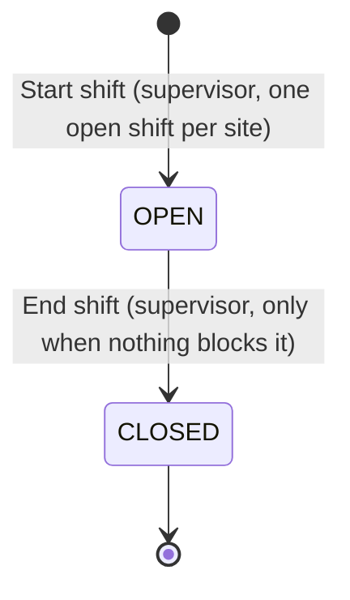
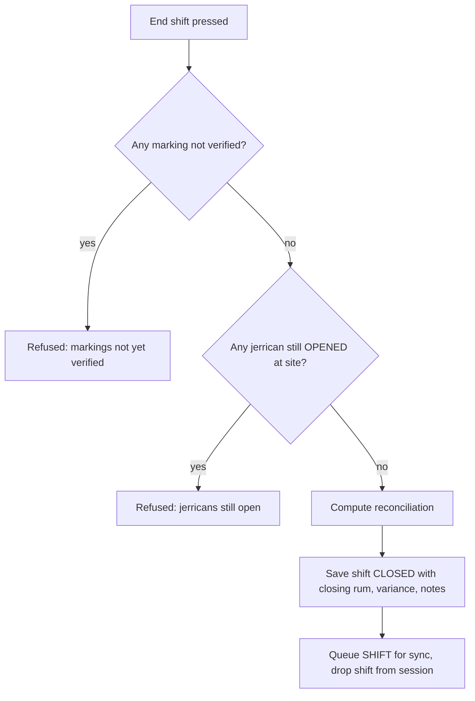

# 1. Shift management

Behaviour of the shift features as they are in the current working tree of branch `fix/transfer-pull-ordering`
(uncommitted changes included). Every statement is taken from the code, the database migrations and the tests named
in the code references; where the code does not do something, the section says so.

Scope: 1.1 Open shift, 1.2 Reopen shift, 1.3 Close shift, 1.3.1 Shift summary.

Terms used below:

- **Desktop** is the JavaFX app at each marking site (`src/`).
- **Central** is the Spring backend that receives the site's changes (`backend/`).
- **Web** is the Angular app that head office uses to read them (`web/`).
- **Rum** amounts are grams (`g`). The `*_ml` column and field names are historical; migrations V10 and later state
  that the values are grams.

## At a glance

| Feature | Status | Where | Role |
|---|---|---|---|
| 1.1 Open shift (start a shift) | Implemented | Desktop, Shift tab, "Start shift" | Supervisor |
| 1.2 Reopen shift | **Not found in code** | - (closest: a closed shift is final; start a new shift) | - |
| 1.3 Close shift (end a shift) | Implemented, with gaps (see review notes) | Desktop, Shift tab, "End shift" | Supervisor |
| 1.3.1 Shift summary | **Partial**: no shift summary screen or report; the figures are on the Shift tab, in the close confirmation and in the web Shifts list | Desktop Shift tab; Web, Shifts page | Supervisor (desktop); Viewer or Admin (web, read-only) |

## Shift lifecycle

A site has at most one open shift at a time (a partial unique index on `shifts` for status `OPEN`, migration V5).
A shift only moves forward: there is no transition from `CLOSED` back to `OPEN`.

---

## 1.1 Open shift

**Status:** Implemented.

**Where / who:** Desktop, the **Shift** screen (first item in the sidebar). Only a **Supervisor** sees this screen
(`MainView`). The service enforces the same rule (`ShiftService.start` calls `Guard.require(..., SUPERVISOR)`).
The web app cannot start a shift; it only lists shifts (1.3.1).

**Preconditions**

- Signed in as a supervisor at the site. On sign-in the desktop looks for an open shift at that site and restores it into
  the session (`LoginView`, `ShiftService.findOpen`). If one is open, the Shift screen shows it and "Start shift" is disabled.
- No shift is open at the site (checked in the same transaction, and enforced by the database index).
- **Mobile sites only:** a location must be chosen. A location is an active entry in the head-office list of locations
  (master data, V27). Retired locations are not offered and are refused by the service.
- Fixed sites may start a shift with no location, or with one.
- Before a shift is open, every sidebar screen except **Shift** and **Reports** is hidden and locked for a supervisor
  (`MainView.applyShiftGate`). Other roles are not gated by shifts on the screen, but their queues show nothing without
  an open shift (see 3.2 and 3.3).

**Behaviour, step by step**

1. The supervisor opens the **Shift** screen. With no shift open it reads "No shift open" and the hint
   "This is a mobile site: choose where you are working, then start the shift." (mobile) or "Start a shift to register
   trucks and open jerricans." (fixed).
2. The **location** box is shown with the prompt "Where are you working? (required)" at a mobile site, or
   "Location (optional)" at a fixed site. The choices are the active locations from master data.
3. The supervisor presses **Start shift**. The system:
   - checks the role;
   - refuses a mobile site without a location;
   - checks that no shift is open at the site;
   - looks up the chosen location (it must still be active) and copies its name onto the shift, so a later rename does
     not change history;
   - records the **opening rum**: the total rum in all jerricans currently `OPENED` at the site (`ContainerDao.openedVolume`);
   - records the supervisor who started the shift and the site;
   - saves the shift as `OPEN` and queues it for sync.
4. The session takes the new shift. The top bar changes to "Shift open since HH:MM", the other screens unlock, and the
   Shift screen shows the status line "Shift OPEN since HH:MM at LOCATION" (location only when one was chosen), with the
   reconciliation figures and the close checklist (1.3).

No signature is captured when a shift starts.

**Validation rules and error messages** (shown in a dialog)

| Condition | Message |
|---|---|
| Mobile site, no location chosen | "Choose where SITE is working before starting the shift" |
| A shift is already open at the site | "A shift is already open at SITE" |
| Location chosen is retired or unknown | "Unknown location NAME - head office may have retired it" |
| Caller is not a supervisor (service guard; the screen is hidden from other roles) | "Action not permitted for role ROLE" |

**Data and state changes**

- `shifts` row inserted: `status = OPEN`, `started_at` = database time, `opening_rum_ml` (grams), `supervisor_id`,
  `site_id`, `location_id` and `location_name` (both empty at a fixed site with no location).
- A `SHIFT` entry is written to the sync outbox in the same transaction. The payload is the shift record, including
  `locationId` and `locationName`.

**Sync and reporting impact**

- The `SHIFT` entry is pushed to central on the site's sync cycle (default 15 seconds, with jitter, see `sync.interval-seconds`).
  If the site is offline it waits in the outbox.
- Central validates the shift (identifier, site, supervisor, status, start time, opening rum) and stores it.
- Web, **Shifts** page: the shift appears with status "OPEN", its site, location and supervisor, and an empty end time.
- Web, dashboard: counts open shifts. The site status view shows the site as having a shift open and shows the location of
  its latest shift.

**Review notes**

- **Any supervisor who signs in at the site inherits an open shift**, whoever opened it (login restores the shift for the
  site, not for the person). There is no check that the person who closes it is the one who opened it (see 1.3).
- **Mobile site with no active locations:** the location box is empty and the only message is "Choose where SITE is
  working before starting the shift". Nothing tells the supervisor that the location list is empty or that master data
  has not arrived. (Tests: `MobileSiteIT`.)
- **Opening rum** counts every jerrican that is open at the site, including ones opened in an earlier shift and not yet
  closed back. This matches the closing logic, but it means a shift's "opening" is not the rum opened during that shift.
- **Shift start is not signed.** The central system lists `SHIFT` among the types a site signs
  (`PayloadChecks.SIGNED_TYPES`), so the expectation is that shifts are signed. Question: is a signature wanted at start,
  close, or neither?
- **Concurrency:** two terminals at one site could both try to start a shift. The database index stops the second insert.
  The error text in that case would be the raw database error, which is not covered by a test. Not verified in a running system.
- The start time is the database clock; the marking times in 3.1 use the desktop clock. See section 3.1 review notes.

**Code references**

- `ui/ShiftTab.java`: `start` handler and `refresh()` (start disabled while open, location prompt, status line).
- `service/ShiftService.java`: `start(AppUser, Site, Location)`, `findOpen`.
- `dao/ShiftDao.java`: `insert`, `findOpen`, `publish` (outbox upsert of the shift).
- `dao/ContainerDao.java`: `openedVolume` (opening rum).
- `ui/LoginView.java`: restores the open shift on sign-in.
- `ui/MainView.java`: `applyShiftGate`, `BEFORE_SHIFT`.
- `dao/MasterDataDao.java`: `locations`, `location` (active locations only).
- Migrations: `V5__Marking_sites_shifts_inventory_sync.sql` (shifts table, one-open-shift index),
  `V27__Locations.sql` (location columns on shifts).
- Tests: `MobileSiteIT` (mobile location rules, retired locations, fixed sites), `CloseBackIT` and `DeleteMarkingIT`
  (shift start as their seed).
- Central: `backend/.../sync/PayloadChecks.java` (`SHIFT` payload checks), `backend/.../web/ReadService.java` (`shifts`),
  `backend/.../web/ReadController.java` (`GET /api/web/shifts`).

---

## 1.2 Reopen shift

**Status:** **Not found in code.**

**What was searched:** the desktop (`src/`), the central backend (`backend/`) and the web app (`web/`) were searched for
reopen, re-open and unclose. Nothing matched. `ShiftService`, `ShiftDao` and `ShiftTab` have no operation that sets a shift
back to `OPEN`.

**Closest behaviour that exists**

- A closed shift is final. `ShiftService.end` refuses a shift that is not `OPEN` with "Shift already closed", and
  nothing else changes a closed shift's status.
- To carry on working after a close, the supervisor starts a **new** shift (1.1). Its opening rum is whatever is open at
  the site at that moment.
- The database only has an index for open shifts, so reopening would also have to respect "one open shift per site".

**Review notes**

- If a reopen is wanted (for example, a shift closed by mistake with a jerrican still open), it would have to answer:
  who may do it, what happens to the closing figures and the variance, whether the closing supervisor's sign-off is
  reversed, and how the central copy is corrected (the central copy is replaced by the latest version of the same shift).
- Until then, a mistaken close can only be followed by a new shift, which starts with the rum open at that point.

---

## 1.3 Close shift

**Status:** Implemented, with gaps listed in the review notes.

**Where / who:** Desktop, **Shift** screen, **End shift** button. Only a supervisor sees the screen, and the service requires
the supervisor role. Any supervisor signed in at the site can close the open shift; the shift does not record who closed it
(see review notes).

**Preconditions** (all checked again by the service, not only by the screen)

1. The shift is `OPEN`.
2. Every marking of the shift is **verified** (status `COMPLETED`). Markings in `REGISTERED`, `DOSED` or `DISPENSED` block
   closing. Deleted markings do not block.
3. No jerrican at the site is `OPENED`. Each must be closed back with a new seal (Jerricans menu, Close jerrican) or
   declared empty (Jerricans menu, Declare empty).

The **End shift** button is enabled only when items 2 and 3 are both clear. The checklist "Before you can close the shift"
is shown while a shift is open and is refreshed when the Shift screen is shown.

**Behaviour, step by step**

1. The supervisor opens the **Shift** screen. The checklist shows two lines, each with a tick or a cross:
   - trucks: "Every truck is verified." or how many trucks are waiting for verification, with a pointer to the Verify screen;
   - jerricans: "No jerrican is left open." or the barcodes still open, with the instruction to close each one back with a
     seal (Close jerrican, if it still holds rum) or declare it empty (Declare empty).
2. The figures are shown and kept up to date while the screen is open (see 1.3.1). "Reconcile stock" opens the Reconcile
   screen. Reconciling is optional for closing; the status line says whether this shift has been reconciled and whether it
   matched.
3. The supervisor may type **closing notes** (optional).
4. The supervisor presses **End shift**. The desktop checks the blockers again, computes the reconciliation as of now,
   and shows a confirmation with expected rum, actual rum and variance.
5. On confirmation the service checks the blockers a third time, computes the reconciliation, and saves the shift as
   `CLOSED` with the end time, the closing rum (the actual), the variance and the notes. It queues the shift for sync.
6. The session drops the shift, the notes box is cleared, and "Shift closed." is shown.

No signature is requested on this path. The service accepts an optional signature, but the screen never supplies one.

**How the reconciliation is computed** (`ShiftService.compute`, used at close and as a live preview)

| Figure | Meaning |
|---|---|
| Opening | Rum in jerricans that were open at the site when the shift started |
| Opened in shift | Rum in jerricans opened (`OPEN` events) at the site since the shift started |
| Dosed into trucks | Sum of the weighed doses of trucks of this shift (see 3.2) |
| Incident losses | Rum lost in incidents of this shift that name a jerrican |
| Closed back | Rum in jerricans sealed again (`CLOSE_BACK` events) at the site since the shift started |
| Expected now | Opening + opened - dosed - incident losses - closed back |
| Actual in opened jerricans | Rum in jerricans `OPENED` at the site now |
| Variance | Actual - expected |

**Validation rules and error messages**

When a blocker exists, the service refuses with the message below. The parts are joined with "; ":

- "The shift cannot be closed yet: " followed by:
  - "1 marking is not yet verified" (or "N markings are not yet verified");
  - "jerrican BARCODE is still open - close it back with a seal, or declare it empty" (for several: "N jerricans A, B are
    still open - close them back with a seal, or declare them empty").

Other messages:

| Condition | Message |
|---|---|
| Shift is not open | "Shift already closed" |
| Caller is not a supervisor | "Action not permitted for role ROLE" |
| Checklist lines on screen | "N trucks are not verified yet - verify them on the Verify tab." / "1 truck is not verified yet - verify it on the Verify tab." |
| Checklist lines on screen | "Still open: A, B. In the Jerricans menu, close each one back with a seal (Close jerrican, if it still holds rum) or declare it empty (Declare empty)." |

The confirmation text reads "Closing the shift." with the expected, actual and variance amounts and "Close the shift?".
The variance box then says one of: "Balanced - nothing unaccounted for" (within 0.05 g), "Less rum than expected - check for
unrecorded loss", or "More rum than expected - check the weights".

**Data and state changes**

- `shifts`: `status` `OPEN` to `CLOSED`; `ended_at` = database time; `closing_rum_ml` = actual; `reconciliation_variance_ml`
  = variance; `notes` = closing notes.
- A `SHIFT` entry is queued with the closed shift. The closing notes are **not** in the payload (see review notes).

**Sync and reporting impact**

- Central receives the closed shift (`status CLOSED`, `endedAt`, `closingRumMl`, `varianceMl`) and replaces its copy.
- Web, **Shifts** page: the row shows the end time, closing rum (g) and variance (g). A variance under 0.05 g shows a green "0";
  any other variance shows a red badge with its value. The dashboard stops counting the shift as open.
- Closing notes are not shown anywhere on the web app and are not sent to central.
- No signature is sent for the close.

**Review notes**

1. **No record of who closed the shift.** The shift row keeps only the supervisor who opened it. The closing supervisor is
   not written anywhere except in an optional signature, and the screen never captures one. Anyone with the supervisor role
   at the site can close a shift someone else opened. Question: should the closing supervisor be recorded, and should a
   signature be required?
2. **Closing notes stay on the desktop.** They are stored locally but are not part of the shift that is synced, so head
   office never sees them. Question: should they sync?
3. **A non-zero variance does not stop the shift closing.** The variance is saved and shown in red on the web, but nothing
   asks for an explanation. (The stock reconciliation screen, by contrast, requires a cause for a shortfall.)
   Question: should a variance above a tolerance need a note or an incident before closing?
4. **Incident losses count only when a jerrican is named.** An incident recorded without a container is not subtracted
   from expected rum, so it would show as variance. Whether such incidents can exist on the desktop was not verified.
5. **Other terminals.** Sign-out clears the shift from the session, but another terminal at the same site keeps showing the
   old shift until its next sign-in. The design assumes one terminal in use per site at a time.
6. **Signature mismatch.** The central system's list of signed types includes `SHIFT`, but the desktop never signs a shift
   close or start. Either the list or the desktop should change.

**Code references**

- `ui/ShiftTab.java`: `endShift()` (confirmation text), `showChecklist(...)`, `showFigures()` (variance wording), notes box.
- `service/ShiftService.java`: `end(AppUser, Shift, byte[], String)`, `closeBlockers`, `blockers`, `countUnverified`,
  `compute` (reconciliation formula).
- `dao/ShiftDao.java`: `close` (the `UPDATE`; notes are written here but not in the payload).
- `dao/ContainerDao.java`: `volumeOpenedSince`, `volumeClosedBackSince`, `openedVolume`.
- `dao/TruckMarkingDao.java`: the status set that counts as verified (`COMPLETED`, `DELETED` excluded).
- Migrations: `V5` (shift columns), `V18__Shift_reconciliation.sql` (shift-kind stock counts).
- Tests: `CloseBackIT` (blocker messages, close after closing back, reconciliation totals of a full shift),
  `WorkflowIT` (a shift cannot close with an unverified marking),
  `DosingIT` (reconciliation variance stays zero after weighed doses).
- Central: `backend/.../sync/PayloadChecks.java` (`SHIFT` checks), `backend/.../web/ReadService.java` (`shifts`, `siteStatus`,
  `overview`).

---

## 1.3.1 Shift summary

**Status:** **Partial.** There is no shift summary screen, shift report or shift detail page. The figures that summarise a
shift exist in three places:

1. **Desktop, Shift screen, while the shift is open:** five figure cards (OPENING, OPENED TODAY, DOSED INTO TRUCKS, INCIDENT
   LOSSES, CLOSED BACK) and the EXPECTED NOW / ACTUAL IN OPENED JERRICANS / VARIANCE row, refreshed when the screen is shown.
   A **g / kg** switch changes how amounts are displayed. The switch is a static setting, so it lasts for the running
   application, not per user or per shift.
2. **Desktop, close confirmation:** expected, actual and variance (1.3).
3. **Web, Shifts page:** a list of shifts for the chosen site, location, status and dates (default: the last 30 days), with
   opening, closing and variance for each shift. It has no detail view.

**Where / who:** the desktop figures are for the supervisor on the Shift screen. The web list needs a VIEWER or ADMIN role
on the central system (`/api/web/**`).

**Behaviour**

- The Shift screen figure "OPENED TODAY" is labelled as today, but the value is the rum opened since the **shift** started
  (`openedVolume` since `started_at`), not since midnight.
- "DOSED INTO TRUCKS" is the sum of weighed doses for trucks of this shift. "INCIDENT LOSSES" counts only losses naming a
  jerrican. "CLOSED BACK" counts rum sealed again since the shift started.
- The web Shifts page columns are: site, location, supervisor, started, ended, status, opening (g), closing (g),
  variance (g). Filters: site, location, status, from and to dates. Paged 25 per page.

**Validation rules and error messages:** none specific to the summary. The Shift screen's "Last reconciled" line reads
"Not reconciled yet this shift. Reconcile any time, or when you close the shift." or "Last reconciled at HH:MM - everything
matched" / "- difference X kg".

**Data and state changes:** none. The summary is computed from the shift row, the containers and the events; nothing is stored
as a summary.

**Sync and reporting impact**

- Central stores no shift summary. It stores the shift row (opening, closing and variance travel with it, see 1.1 and 1.3)
  and the synced markings, incidents and containers. The other summary figures (opened, dosed, losses, closed back) are
  not stored on central; they exist only on the desktop, computed live from the local data.
- The desktop **Reports** screen lists these reports: inventory; marking summary by fuel type; marking summary by oil company;
  marking detail per truck; incidents; transfers; stock counts. None of them is filtered by shift. The marking detail and
  summaries filter by date range and site.
- On the web, the markings list can filter by site, location, oil company, fuel, status, search text and dates, but not by
  shift. So a web user cannot list "the trucks of shift N" in one place.

**Review notes**

- **No single shift summary.** A reviewer wanting "what happened in this shift" (trucks registered, dosed, dispensed,
  verified; rum in and out; incidents; who opened and closed) has to combine the Shift screen, the Markings list filtered by
  date, and the Incidents list. Question: is a shift summary wanted, and should it be a web page, a desktop report, or both?
- **Shift is not a filter on markings or incidents on the web.** The shift identifier is present in the synced data
  (the marking's `shiftId`), but the web does not expose it as a filter. Question: is this intended?
- **Label:** "OPENED TODAY" should probably read "OPENED THIS SHIFT" (see above).
- **Units on the web:** the Shifts page labels amounts as grams, which matches the stored values. The g / kg switch is
  desktop-only.

**Code references**

- `ui/ShiftTab.java`: figure cards, `showFigures()`, the unit switch (`Ui.rumInKg`, `Ui.rumAmount`), "Last reconciled" line.
- `service/ShiftService.java`: `reconcile(Shift)` (computes the figures).
- `service/ReportService.java` (report kinds) and `dao/ReportDao.java`.
- `backend/.../web/ReadController.java`: `GET /api/web/shifts`, `GET /api/web/markings` (no shift filter).
- `backend/.../web/ReadService.java`: `shifts(...)`, `markings(...)`, `siteStatus()`.
- `web/src/app/pages/shifts.component.ts`: the Shifts list and its filters.
