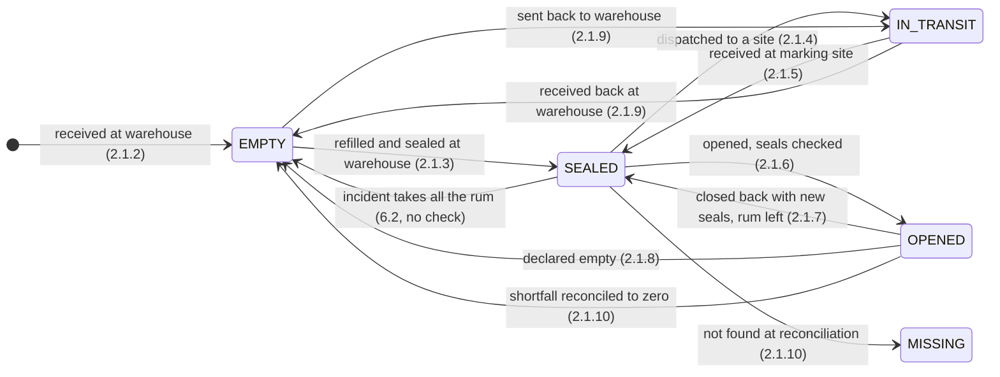
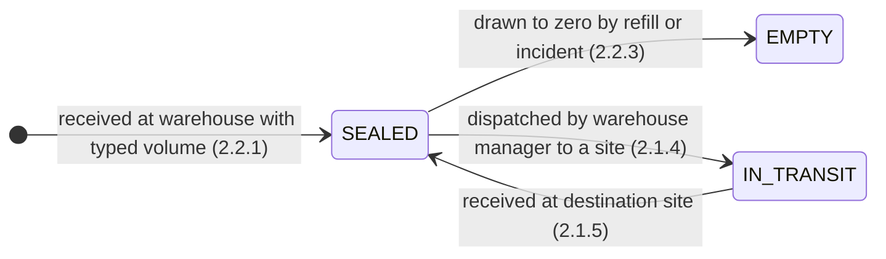

# 2. Container management

This page describes how the system **actually behaves** for containers: jerricans (plastic and metal) and bulk containers (IBCs and drums). Every statement is taken from the code and the tests in this repository. Where the code is silent or the tests disagree with the code, the section says so under **Review notes**.

- Desktop app (`src/`): the warehouse manager's and the supervisor's screens at a site.
- Central backend (`backend/`): registration of jerricans and the sync of containers, transfers and incidents to head office.
- Web app (`web/`): the Jerricans admin page, and the read-only Transfers, Inventory and Stock counts pages.

Terms used throughout:

- **Container**: a jerrican or a bulk container (IBC or drum). Bulk containers are the `BULK` category in container-type master data; jerricans are `JERRICAN`.
- **Status**: the stored `containers.status` value. See the table below.
- **Site**: a warehouse or a marking site. A container's `site_id` is where it is held. A container in transit keeps the sender's `site_id` until it is received.
- **Units**: rum is stored in grams. Desktop screens show kilograms and convert, with one decimal of a gram of precision. The Incidents screen is the exception: it takes grams.
- **Working tree**: the backend transfer-ordering changes that are not yet committed on branch `fix/transfer-pull-ordering`. Sections that depend on them say so. Where HEAD behaves differently, that is stated too.

## Container status values

| Status | Meaning | Set by |
|---|---|---|
| `EMPTY` | Holds no rum. A jerrican has no seals in this state. | Receiving an empty jerrican; declaring a jerrican empty; receiving a returned jerrican; drawing a container down to zero. |
| `SEALED` | Holds rum and is sealed, ready to dispatch, open, or count. Bulk containers are `SEALED` once received. | Refilling a jerrican; receiving a transfer; closing a jerrican back with new seals; receiving a bulk container. |
| `OPENED` | A jerrican in use: its seals are broken and its rum is in the shift's opened total. | Opening a jerrican. |
| `IN_TRANSIT` | Dispatched and not yet received. `site_id` still names the sender. | Dispatching a transfer, or sending empties back. |
| `MISSING` | A sealed jerrican not found at a reconciliation. No transition out exists in the code. | Reconciliation (2.1.10). |

The `containers.status` column has no database CHECK constraint. The comment in the inventory migration (`src/main/resources/db/migration/V5__Marking_sites_shifts_inventory_sync.sql`) lists `IN_STOCK | IN_TRANSIT | SEALED | OPENED | EMPTY` and does not list `MISSING`. Nothing in the code sets `IN_STOCK`, although it is the column default.

## Lifecycle: jerricans

Each transition names the operation that causes it. Jerricans must first be registered at head office (2.1.1); the warehouse cannot receive an unregistered or retired one.

Caption: the end-to-end path of a jerrican, from head-office registration through the warehouse, a marking site, and back. The last transition is an edge case: an incident that names a sealed jerrican and removes all its rum also makes it `EMPTY`, without the declare-empty steps (see 6.2).

## Lifecycle: IBCs and drums

Bulk containers have no registration, no opening, and no empty action. Their rum leaves only by refilling jerricans (2.1.3), by an incident (6.2), or by being drawn to zero.

Caption: the states a bulk container can reach. The warehouse stock count (2.2.4) reads these containers and changes none of them. An `EMPTY` bulk container has no transition out: it cannot be dispatched, it cannot be sent back, and no screen removes it from stock.

## At a glance

### 2.1 Jerrican management

| Feature | Status | Where | Role |
|---|---|---|---|
| 2.1.1 Create jerrican (web app) | Implemented | Web app, Admin > Jerricans | Admin (web) |
| 2.1.2 Receive empty jerrican at warehouse | Implemented | Desktop, Jerricans > Receive jerrican | Warehouse manager |
| 2.1.3 Refill jerrican at warehouse | Implemented | Desktop, Jerricans > Refill jerrican | Warehouse manager |
| 2.1.4 Transfer jerrican warehouse to marking site | Implemented | Desktop, Jerricans > Transfer jerrican | Warehouse manager |
| 2.1.5 Receive full jerrican at marking site | Implemented | Desktop, Jerricans > Receive jerrican | Supervisor (open shift) |
| 2.1.6 Open jerrican at marking site | Implemented | Desktop, Jerricans > Open jerrican | Supervisor (open shift) |
| 2.1.7 Close jerrican at marking site | Implemented | Desktop, Jerricans > Close jerrican | Supervisor (open shift) |
| 2.1.8 Empty jerrican at marking site | Implemented | Desktop, Jerricans > Declare empty | Supervisor (open shift) |
| 2.1.9 Transfer jerrican marking site to warehouse | Implemented | Desktop, Jerricans > Transfer jerrican (send); Receive returns (receive) | Supervisor (send); warehouse manager (receive) |
| 2.1.10 Reconcile jerricans at marking site | Implemented | Desktop, Reconcile | Supervisor (open shift) |

### 2.2 IBC and drum management

| Feature | Status | Where | Role |
|---|---|---|---|
| 2.2.1 Receive IBC at warehouse | Implemented | Desktop, Receive IBC / drum | Warehouse manager |
| 2.2.2 Open IBC at warehouse | Not found | none | none |
| 2.2.3 Empty IBC at warehouse | Not found (closest: drawn to zero) | none | none |
| 2.2.4 Reconcile IBC at warehouse | Implemented (record only) | Desktop, Stock count; web, Stock counts | Warehouse manager |

---

## 2.1 Jerrican management

### 2.1.1 Create jerrican (web app)

- **Status**: Implemented. Jerricans are registered in the web app. The desktop cannot create one.
- **Where / who**: Web app, Admin > Jerricans, with the "Register jerricans" button. The backend's `/api/admin/**` routes require the `ADMIN` role.
- **Preconditions**: Signed in as an admin. Active rum types and active jerrican container types exist in master data.
- **Behaviour**:
  1. Press **Register jerricans**.
  2. Choose the container type. The list offers active `JERRICAN` types and shows each one's seal count. Choosing a type fills in its usual capacity (the starting list has 22 kg for plastic and 18 kg for metal). The capacity can be changed.
  3. Choose an active rum type.
  4. Enter one or more jerrican ids, one per line, for a new registration. Blank lines are ignored and ids are trimmed.
  5. Press **Register N jerrican(s)**. The page reports "N jerrican(s) registered." The list then shows each jerrican with its type, capacity, rum type and "Where it is".
  6. To change an existing jerrican, press **Edit**. The barcode, container type, capacity and rum type can be changed. **Retire** and **Restore** toggle `active`. Retired jerricans stay in the list; they are not deleted.
- **Validation rules & error messages**:
  - Web form: **Register** stays disabled until capacity is above zero, a container type and rum type are chosen, and at least one id is present.
  - Backend, single jerrican: `barcode is required`; `containerTypeId is required`; `Unknown container type`; `<type name> is not a jerrican type`; `capacity must be more than zero`; `rumTypeId is required`; `Unknown rum type`.
  - Backend, bulk: `barcodes is required` when no id remains after trimming; `Barcode <id> is listed twice`. A bulk registration is all-or-none: one bad id rejects the whole batch.
  - Duplicate barcode: the database enforces uniqueness (`registered_jerricans.barcode`). No friendly message was found in the code; the web will show a generic failure.
- **Data / state changes** (head office):
  - `registered_jerricans`: one row per jerrican (barcode, container type, capacity in grams, rum type, `active`).
  - `audit_log`: `JERRICAN_REGISTER` on create, `JERRICAN_UPDATE` on edit. A retired jerrican's audit detail ends with `(inactive)`.
  - Master-data outbox: a `JERRICAN` message is queued for the master-data topic.
- **Sync & reporting impact**:
  - The master-data message reaches each site through the Kafka master-data topic and the site's `MasterDataConsumer`. `MasterDataApplier.jerrican` writes the site's `registered_jerricans` row. A message that refers to a container type or rum type the site has not seen yet waits and is retried.
  - The desktop only accepts a receipt for an **active** registration (`MasterDataDao.registeredJerrican`).
  - The web "Where it is" column reads the latest `CONTAINER` record that any site has reported for that barcode. It shows "not received yet" until then.
- **Review notes**:
  - **Edit after receipt.** Changing a jerrican's barcode, rum type or capacity updates only the registration. A site that already holds the jerrican keeps its own container row, with the barcode, rum type and capacity it had at receipt. Should edits to a received jerrican be blocked, or propagated?
  - **Retire does not remove stock.** A retired jerrican already at a site stays there with its status. Retiring only stops new receipts. Confirm that this is the intent.
  - **Duplicate barcode message.** The duplicate case depends on the database error. Consider a clear message.
  - **Capacity change.** A new capacity applies only to future receipts, because the site copies capacity into its container row at receipt.
- **Code references**:
  - `web/src/app/pages/admin/jerricans.component.ts`: `AdminJerricansComponent` (`startNew`, `usual`, `save`, `toggle`).
  - `web/src/app/core/api.service.ts`: `jerricans`, `saveJerrican`, `registerJerricans`.
  - `backend/src/main/java/org/jai/fuelmarking/central/master/AdminController.java`: `registerJerrican`, `updateJerrican`, `registerJerricans`.
  - `backend/src/main/java/org/jai/fuelmarking/central/master/MasterDataService.java`: `saveJerrican`, `saveJerricans`, `jerricanRows`, `require`.
  - `src/main/java/org/jai/fuelmarking/sync/MasterDataApplier.java`: `jerrican`.
  - `src/main/java/org/jai/fuelmarking/dao/MasterDataDao.java`: `registeredJerrican` (active only).

### 2.1.2 Receive empty jerrican at warehouse

- **Status**: Implemented.
- **Where / who**: Desktop, Jerricans > **Receive jerrican** (`WarehouseTab`, receive mode). Warehouse manager only.
- **Preconditions**:
  - The jerrican is registered at head office and active, and that registration has reached this site.
  - Rum type is chosen, or is filled in automatically from the registration.
  - No shift is needed. The warehouse manager does not work in shifts.
- **Behaviour**:
  1. Scan or type the jerrican id. When the field loses focus or Enter is pressed, the screen looks it up and shows its container type, capacity, seal count and registered rum type, and selects that rum type.
  2. If the id is not registered, the panel says "Not registered at head office - it cannot be received."
  3. Press **Receive empty jerrican**. On success the screen says "Jerrican received." and the id field clears.
  4. The result is `EMPTY`, with no rum, no seals and no weighing. The screen notes: "It stays EMPTY until it is refilled and sealed."
- **Validation rules & error messages**:
  - `Enter the jerrican id`
  - `Jerrican <id> is not registered at head office. Register it in the web app first (it reaches the warehouse within seconds).`
  - `Choose the rum type`
  - `Jerrican <id> is registered for rum type <registered>, not <chosen>`
  - `Jerrican <id> is already in the system (<status>)`. A jerrican already at this site, or anywhere else, cannot be received again.
  - Role check: `Action not permitted for role <role>`.
- **Data / state changes**:
  - A new `containers` row: status `EMPTY`, current volume 0, no seals, `site_id` = this warehouse, capacity, container type and rum type from the registration, `received_at` = now.
  - A `CONTAINER` outbox event.
  - No `signatures` row and no transfer.
- **Sync & reporting impact**: The `CONTAINER` event goes to head office. The web Jerricans page then shows the warehouse's name and status `EMPTY`. The receipt is not signed and nothing else at head office records it.
- **Review notes**:
  - **Unsigned receipt.** Stock counts and shift actions are signed; this receipt is not. The only record is the container row and its outbox event.
  - **Retired jerricans.** A retired registration gives the same message as an unregistered id ("is not registered at head office"). That wording is misleading for a retired one.
  - **Returned jerricans.** A jerrican that is out at a site, or was sent back, is "already in the system". It returns only through the transfer route (2.1.9).
- **Code references**:
  - `src/main/java/org/jai/fuelmarking/ui/WarehouseTab.java`: receive-jerrican section and lookup.
  - `src/main/java/org/jai/fuelmarking/service/ContainerService.java`: `receiveEmptyJerrican`, `registeredJerrican`.
  - `src/main/java/org/jai/fuelmarking/dao/MasterDataDao.java`: `registeredJerrican`.
  - `src/main/java/org/jai/fuelmarking/dao/ContainerDao.java`: `insert`.

### 2.1.3 Refill jerrican at warehouse

- **Status**: Implemented. Two gaps are listed under Review notes.
- **Where / who**: Desktop, Jerricans > **Refill jerrican** (`WarehouseTab`, refill mode). Warehouse manager only.
- **Preconditions**:
  - The jerrican is known to the site and is `EMPTY`.
  - The IBC or drum holds the same rum type the jerrican is registered for.
  - The jerrican has one seal (plastic) or two (metal).
  - The IBC or drum holds at least the quantity being filled.
- **Behaviour** (the screen's steps, as written on it):
  1. Put the EMPTY jerrican on the scale and press **Tare scale**.
  2. Fill it from the IBC or drum while watching the display.
  3. Press **Read scale**. The net weight is the rum filled. It can also be typed in kilograms.
  4. Scan both barcodes, type the seal number or numbers fitted, and press **Refill and seal**.
  - Once the jerrican is scanned, the screen shows how many seals it needs, its capacity, rum type and status. If it is not `EMPTY`, the screen's hint says "only an EMPTY jerrican can be refilled", and the service refuses the refill when submitted.
  - The service runs in one transaction. It locks both containers, checks everything, then reduces the bulk container's volume and sets the jerrican to `SEALED` with its volume, seals and source container.
- **Validation rules & error messages** (checked in this order):
  - `Quantity must be positive`
  - `Unknown IBC/drum <barcode>`
  - `Unknown jerrican <id> - receive it as an empty jerrican first`
  - `Refill goes from IBC/drum to jerrican`
  - `Jerrican <id> is <status>; only an EMPTY jerrican can be refilled`
  - `Rum type mismatch: <bulk> holds <rum> but jerrican <id> is for <rum>`
  - Seals: `Enter the seal number: a plastic jerrican has one seal`; `A plastic jerrican has only one seal - leave the second seal empty`; `Enter both seal numbers: a metal jerrican has two seals`; `The two seals of a metal jerrican must have different numbers`
  - `Seal <n> was the seal on this jerrican before - fit a new seal`
  - `Seal <n> is already on container <barcode>`
  - `Seal <n> was used before (on <barcode>) and has been discarded - fit a new seal`
  - `Bulk container holds only <grams> g`. This shows raw grams, while the screen works in kilograms.
  - `Exceeds jerrican capacity`
  - Screen input: `Quantity must be a number of kg`.
- **Data / state changes**:
  - IBC or drum: `current_volume_ml` reduced by the quantity. If it reaches exactly zero, `status` becomes `EMPTY`.
  - Jerrican: `current_volume_ml` = quantity; `top_seal`, `bottom_seal` set; `source_container_id` = the bulk container; `status` = `SEALED`.
  - Two `CONTAINER` outbox events.
  - No signature, no transfer, no incident.
- **Sync & reporting impact**: Both containers are reported to head office. The web Inventory page shows the jerrican as `SEALED` with its seals, and the bulk container with its lower volume. The stock count (2.2.4) reads the lower bulk volume.
- **Review notes**:
  - **Refill is not signed.** `ContainerService.refill` takes no signature and writes no `signatures` row. Every other warehouse count and every shift action is signed.
  - **No location check.** `refill` looks both containers up by barcode across all sites. It never compares their `site_id` with the warehouse. A jerrican declared empty at a marking site (`EMPTY`, still at that site, awaiting return) can therefore be refilled from the warehouse screen. It would then be `SEALED` at the marking site, and the warehouse's IBC volume would drop. The same applies to an IBC or drum at another site. This looks like a defect; confirm.
  - **Scale reading not recorded.** The refill stores the quantity only. It does not record whether it was weighed or typed (the stock count does).
  - **Exact-zero rule.** A bulk container with a fraction of a gram left stays `SEALED`. Only an exact zero becomes `EMPTY`. No tolerance is applied here, unlike reconciliation (1 g).
  - **Seal checks before volume checks.** A seal problem is reported before a volume or rum-type problem.
  - **No partial top-up.** A jerrican can only be refilled from `EMPTY`. A partly filled jerrican cannot be topped up.
- **Code references**:
  - `src/main/java/org/jai/fuelmarking/ui/WarehouseTab.java`: refill section (`describeJerry`, refill action).
  - `src/main/java/org/jai/fuelmarking/service/ContainerService.java`: `refill`.
  - `src/main/java/org/jai/fuelmarking/service/Seals.java`: `check`.
  - `src/main/java/org/jai/fuelmarking/dao/ContainerDao.java`: `markFilled`, `setVolume`, `sealUsedBy`, `sealDiscardedFrom`.

### 2.1.4 Transfer jerrican warehouse to marking site

- **Status**: Implemented. The same screen also sends IBCs and drums to any site (see Review notes).
- **Where / who**: Desktop, Jerricans > **Transfer jerrican** (`TransferTab`, send mode, warehouse manager). The intro reads "Send sealed jerricans (or IBCs and drums) to another site."
- **Preconditions**: The containers are `SEALED` and at this warehouse. A destination site is chosen. The sender is the warehouse manager.
- **Behaviour**:
  1. Choose the destination site. Every site except this one is listed.
  2. Scan a container and press **Add to transfer**. The list shows its barcode, type, rum type and rum in kilograms.
  3. Remove any row with **Remove selected**.
  4. Press **Dispatch**. A confirmation asks "Dispatch N container(s) to <site>?". On success the screen says "Transfer dispatched." and clears the list.
  - No weighing and no signature. The UI passes no signature to the service.
- **Validation rules & error messages**:
  - Screen: `Choose the destination site`; `Scan a container barcode`; `<code> is already on the list`; `Unknown container <code>`; `<code> is not at this site`; `<code> is <status> - only sealed containers can be dispatched`.
  - Service: `Choose a different destination site`; `Add at least one container`; `A container is listed twice`; `<barcode> is not at <site>`; `<barcode> is <status>, only SEALED containers can be dispatched`.
- **Data / state changes**:
  - A `transfers` row: `kind` = `SUPPLY`, `status` = `DISPATCHED`, `dispatched_by` = the manager.
  - One `transfer_items` row per container.
  - Each container: `status` = `IN_TRANSIT`. `site_id` stays the warehouse.
  - Outbox: a `CONTAINER` event per container, then a `TRANSFER` event with its items.
- **Sync & reporting impact**:
  - The receiving site pulls the transfer. The backend returns transfers that name the site as sender or receiver and were last written by another site, with the latest state of each container they name. The site's `SyncAgent` applies them through `InboundApplier`.
  - **Working tree.** A pushed transfer becomes pullable only after `SyncSequencer` numbers it. The sequencer runs about once a second, numbers up to 1,000 committed transfers per batch, and runs up to 20 batches per tick. It fixes a race in which a transfer committed late could be skipped by a site whose cursor had already moved past it.
  - **HEAD.** The push numbers the transfer at write time with `nextval`. That is the race the working tree fixes.
  - **Custody checks.** After a push commits, `CustodyConflicts` checks each open transfer. It flags a container that is in another open transfer from a different sender, or whose latest central record names a different site. Flags go to `audit_log` as `SYNC_CONFLICT`, capped at 50 per push. The push is still accepted. The Transfers pages of the web app do not show the flags.
  - The web Transfers page shows the transfer as "In transit" with its containers "in transit".
- **Review notes**:
  - **No destination check.** `TransferService.dispatch` only checks that the destination is a different site. A warehouse can send to any site, including another warehouse. Confirm whether supplies should go only to marking sites.
  - **No signature.** The scanned list and the confirmation are the only record of a dispatch. The service supports an optional signature, but the screen never asks for one.
  - **IBC one-way.** An IBC sent to a marking site cannot come back: returns are jerricans only (2.1.9), and a dispatch needs the sender to be a warehouse holding the container as `SEALED`.
  - **Custody flags need someone to read them.** They appear only in the audit log, through the admin audit endpoint (`/api/admin/audit`, filterable by action).
- **Code references**:
  - `src/main/java/org/jai/fuelmarking/ui/TransferTab.java`: `add`, `dispatch`, `titleFor`.
  - `src/main/java/org/jai/fuelmarking/service/TransferService.java`: `dispatch`.
  - `src/main/java/org/jai/fuelmarking/dao/TransferDao.java`: `insert`, `addItem`, `publish`.
  - `src/main/java/org/jai/fuelmarking/dao/ContainerDao.java`: `setLocation`.
  - `src/main/java/org/jai/fuelmarking/sync/SyncAgent.java`: `pushOnce`, `pullOnce`.
  - `src/main/java/org/jai/fuelmarking/sync/InboundApplier.java`: `transfer`, `container`.
  - `backend/src/main/java/org/jai/fuelmarking/central/sync/SyncService.java`: `push`, `pull`, `upsert`.
  - `backend/src/main/java/org/jai/fuelmarking/central/sync/SyncSequencer.java`: `sequence` (working tree).
  - `backend/src/main/java/org/jai/fuelmarking/central/sync/CustodyConflicts.java`: `check`, `record`.
  - `backend/src/main/resources/db/migration/V18__Sequence_after_commit.sql` (working tree, untracked).
  - Tests: `backend/src/test/java/org/jai/fuelmarking/central/TransferSyncIT.java`, `SequencerScheduleIT.java`, `PushConcurrencyIT.java`.

### 2.1.5 Receive full jerrican at marking site

- **Status**: Implemented. Receipt can be partial.
- **Where / who**: Desktop, Jerricans > **Receive jerrican** (`TransferTab`, receive mode, supervisor). Needs an open shift at this site.
- **Preconditions**:
  - An incoming transfer addressed to this site is listed. It appears once the site has pulled it.
  - The supervisor has an open shift at this site.
- **Behaviour**:
  1. Select an incoming transfer. Each one reads "From <site> - sent <date time> - N container(s)".
  2. The table lists the transfer's containers that have not been received. Each has a **Received** tick box, which is **ticked by default**.
  3. Untick any container that did not arrive.
  4. Press **Receive ticked containers**. The screen says "Received N container(s)." The transfer moves to received only when every item has been received. Until then it stays in the incoming list.
  - No weighing, no seal re-check and no signature on this screen.
- **Validation rules & error messages**:
  - Screen: `Select an incoming transfer`; `Tick at least one container that arrived`.
  - Service: `Select at least one container to receive`; `Transfer already received`; `Start a shift first` (no open shift at the destination); `Unknown container <barcode>`; `Container is not an outstanding item of this transfer`.
- **Data / state changes**:
  - `transfer_items.received_at` set for each ticked container.
  - When all items are received: `transfers.status` = `RECEIVED`, with `received_by` and `received_at`.
  - Each container: `site_id` = this site, `status` = `SEALED`.
  - Outbox: a `CONTAINER` event per container and a `TRANSFER` event with the receipt.
- **Sync & reporting impact**: The `TRANSFER` event carries the new receipt, so the sender's pull shows the transfer and its containers as received. **Working tree**: the receipt is re-numbered after commit, the same as a dispatch (2.1.4). The web Transfers page shows "received of containers".
- **Review notes**:
  - **Default-ticked boxes.** Every container is ticked when the list appears. Pressing receive without unticking accepts every listed container, including one that did not arrive. Consider unticked by default.
  - **Receiving site not checked in the service.** `TransferService.receive` checks the shift at the transfer's destination, but not that the receiving session is that destination. The screen limits the list to this site, so only a direct service call could receive for another site.
  - **Seals not re-checked on receipt.** Seal numbers are checked when a jerrican is opened (2.1.6), not when it is received. A seal broken in transit is found only at opening.
  - **Unsigned.** The service accepts an optional receipt signature, but the screen does not ask for one.
- **Code references**:
  - `src/main/java/org/jai/fuelmarking/ui/TransferTab.java`: `showItems`, `receive`, `Incoming`.
  - `src/main/java/org/jai/fuelmarking/service/TransferService.java`: `receive`, `requireShift`.
  - `src/main/java/org/jai/fuelmarking/dao/TransferDao.java`: `recordReceipt`, `allReceived`, `markReceived`, `incoming`.
  - `src/main/java/org/jai/fuelmarking/sync/InboundApplier.java`: `transfer`, `container`.

### 2.1.6 Open jerrican at marking site

- **Status**: Implemented.
- **Where / who**: Desktop, Jerricans > **Open jerrican** (`OpenJerricanTab`, open mode). Supervisor with an open shift. The left-hand list shows sealed jerricans as cards, and a barcode box finds one by scan or typing.
- **Preconditions**: An open shift. The jerrican is at this site and `SEALED`. A signature is captured.
- **Behaviour**:
  1. Choose the jerrican from the **Sealed** list, or scan or type its barcode.
  2. Type the seal number read off the jerrican. A metal jerrican also needs the second seal.
  3. Press **Seals checked - open jerrican**.
  4. Sign on the pad: "<name> - sign to confirm seals opened for <barcode>".
  5. The jerrican moves to the **Opened** list. The volume at opening is recorded.
- **Validation rules & error messages**:
  - `Start a shift first`
  - Signature: `Signature is required`
  - `Unknown container <barcode>`
  - `Not a jerrican`
  - `Container belongs to another site`
  - `Container is <status>`. For example `OPENED`, `MISSING`, `IN_TRANSIT` or `EMPTY`.
  - Seal format messages as in 2.1.3.
  - `Seal numbers do not match records - report an incident`
  - Screen: when the scanned barcode is already open, the screen says it is "already open - close it on the Close jerrican screen, or declare it empty on the Declare empty screen".
- **Data / state changes**:
  - `containers`: `status` = `OPENED`, `opened_at`, `opened_by`, `volume_at_open_ml` = current volume.
  - `container_events`: an `OPEN` row with the volume.
  - `signatures`: step `OPEN_JERRICAN:<barcode>`.
  - Outbox: a `CONTAINER` event.
- **Sync & reporting impact**: The opened volume goes into the shift's expected figure (`ShiftService.reconcile`). A shift cannot be closed while any jerrican at the site is `OPENED` (`ShiftService.closeBlockers`). The web Inventory shows the jerrican as `OPENED`.
- **Review notes**:
  - **A seal mismatch is refused, not recorded.** The message tells the supervisor to report an incident, but nothing raises one. The jerrican stays `SEALED`. Should a mismatch be recorded automatically?
  - **No volume check.** Opening takes the system's volume as the truth. Nothing compares it with a weight or any other check.
- **Code references**:
  - `src/main/java/org/jai/fuelmarking/ui/OpenJerricanTab.java`: `open`, `showPane`, `findScanned`.
  - `src/main/java/org/jai/fuelmarking/service/ContainerService.java`: `openJerrican`.
  - `src/main/java/org/jai/fuelmarking/dao/ContainerDao.java`: `markOpened`, `recordEvent`.
  - `src/main/java/org/jai/fuelmarking/service/Seals.java`: `check`.
  - `src/main/java/org/jai/fuelmarking/service/ShiftService.java`: `closeBlockers`, `reconcile`.

### 2.1.7 Close jerrican at marking site

- **Status**: Implemented. "Close back" is the term used on screen.
- **Where / who**: Desktop, Jerricans > **Close jerrican** (`OpenJerricanTab`, close mode). Supervisor with an open shift. The screen lists opened jerricans. The section "Not finished - it still holds rum" is used here.
- **Preconditions**: An open shift. The jerrican is `OPENED` and holds at least 1 g of rum. New seals are on hand. A signature is captured.
- **Behaviour**:
  1. Choose an opened jerrican. The screen shows how much rum it still holds.
  2. Read the instruction: "Put the cap back and fit a NEW seal (the one it was opened with is broken). It returns to sealed stock for the next shift."
  3. Type the new seal number, and the second one for a metal jerrican.
  4. Press **Close jerrican back & sign**, then sign: "<name> - sign to close <barcode> back with a new seal".
  5. The jerrican returns to `SEALED` with its contents unchanged. The screen says "<barcode> is closed back with its new seal and is in sealed stock again."
- **Validation rules & error messages**:
  - `Start a shift first`
  - `Not a jerrican`; `Container belongs to another site`
  - `<barcode> is <status> - only an opened jerrican can be closed back`
  - `<barcode> is used up - declare it empty instead of closing it back` (under 1 g)
  - Seal format messages as in 2.1.3
  - `Seal <n> is the seal that was broken when <barcode> was opened - fit a new seal`
  - `Seal <n> is already on container <barcode>`
  - `Seal <n> was used before (on <barcode>) and has been discarded - fit a new seal`
  - Signature: `Signature is required`
- **Data / state changes**:
  - `containers`: new `top_seal` / `bottom_seal`; `status` = `SEALED`; volume unchanged.
  - `discarded_seals`: the two seals that were broken are recorded, so neither can be used again.
  - `container_events`: a `CLOSE_BACK` row with the volume at that moment.
  - `signatures`: step `CLOSE:<barcode>`.
  - Outbox: a `CONTAINER` event.
- **Sync & reporting impact**: The rum closed back leaves the shift's opened total (`volumeClosedBackSince`), so the shift still adds up. Head office sees only the container's new state, `SEALED` with its new seals.
- **Review notes**:
  - **Closing back does not weigh.** The record's volume carries over. The only weighing of opened jerricans is the reconciliation (2.1.10).
  - **Threshold.** The 1 g threshold is the reconciliation tolerance (`ReconcileService.TOLERANCE_G`), not a dedicated rule for closing.
  - **Discarded-seal rule.** The check against discarded seals is what stops a broken seal from being reused. It covers the seals of this jerrican and of any other container.
- **Code references**:
  - `src/main/java/org/jai/fuelmarking/ui/OpenJerricanTab.java`: `closeBack`, `showPane`.
  - `src/main/java/org/jai/fuelmarking/service/ContainerService.java`: `closeBack`.
  - `src/main/java/org/jai/fuelmarking/dao/ContainerDao.java`: `markClosedBack`, `rememberSeals`, `sealUsedBy`, `sealDiscardedFrom`, `recordEvent`.
  - Tests: `src/test/java/org/jai/fuelmarking/CloseBackIT.java`.

### 2.1.8 Empty jerrican at marking site

- **Status**: Implemented. The screen is **Declare empty**; the status is `EMPTY`.
- **Where / who**: Desktop, Jerricans > **Declare empty** (`OpenJerricanTab`, empty mode). Supervisor with an open shift.
- **Preconditions**: An open shift. The jerrican is `OPENED` at this site. A signature is captured.
- **Behaviour**:
  1. Choose an opened jerrican.
  2. If it holds 1 g or more, choose what happened to the rum left: **SPILLAGE**, **LEAKAGE** or **OTHER** (the screen asks "What happened to the rum left?"), and add a note (required for OTHER). If it is used up, no cause is asked for.
  3. Press **Declare empty & sign**. A confirmation shows the rum that will be recorded as an incident, and says the seals will be discarded.
  4. Sign: "<name> - sign to declare <barcode> empty".
  5. The screen says "<barcode> is empty. Send it back to the warehouse from the Transfer jerrican screen."
- **Validation rules & error messages**:
  - `Start a shift first`; `Not a jerrican`; `Container belongs to another site`
  - `<barcode> is <status> - only an opened jerrican can be declared empty`
  - `<kg> kg of rum is still shown in <barcode> - say what happened to it: spillage, leakage or other`
  - `Describe what happened to the rum that was left (cause is other)`
  - Signature: `Signature is required`
- **Data / state changes**:
  - `containers`: `status` = `EMPTY`; volume 0; `top_seal` and `bottom_seal` cleared.
  - `discarded_seals`: the seals are recorded as used.
  - If rum was left: an `incidents` row. Its type is the cause chosen, its quantity is the rum left, its description is "Jerrican declared empty with rum left" (plus ": <note>" if given), and its rum type is the jerrican's. See 6.1 and 6.2.
  - `signatures`: step `EMPTY:<barcode>`.
  - Outbox: `CONTAINER`, and `INCIDENT` when there was rum.
- **Sync & reporting impact**: The web Incidents page shows the incident. The shift's expected figure takes off the incident, because it names a container, so the shift still balances. The web Inventory shows the jerrican `EMPTY`.
- **Review notes**:
  - **Silent write-off under 1 g.** Rum below 1 g is set to zero with no incident and no cause.
  - **Empty jerricans are not counted.** A declared-empty jerrican waiting to go back stays at the marking site. No count covers it, but it holds no rum.
  - **Other routes to EMPTY.** A reconciliation shortfall that reaches zero (2.1.10), or an incident that takes all the rum (6.2), also makes the jerrican `EMPTY` and discards its seals, without this screen.
- **Code references**:
  - `src/main/java/org/jai/fuelmarking/ui/OpenJerricanTab.java`: `declareEmpty`, `showPane`.
  - `src/main/java/org/jai/fuelmarking/service/ContainerService.java`: `declareEmpty`.
  - `src/main/java/org/jai/fuelmarking/service/IncidentService.java`: `reportIn`.
  - `src/main/java/org/jai/fuelmarking/dao/ContainerDao.java`: `setVolume`, `discardJerricanSeals`.
  - Tests: `src/test/java/org/jai/fuelmarking/ReturnEmptyIT.java`, `IncidentRumIT.java`.

### 2.1.9 Transfer jerrican marking site to warehouse

- **Status**: Implemented. This is the empties-back route.
- **Where / who**:
  - Send: Desktop, Jerricans > **Transfer jerrican** (`TransferTab`, send mode, supervisor). Intro: "Send finished (empty) jerricans back to a warehouse for a refill."
  - Receive: Desktop, Jerricans > **Receive returns** (`TransferTab`, receive mode, warehouse manager). Intro: "Take in what was sent to this warehouse - finished jerricans coming back, for example."
- **Preconditions**:
  - Send: an open shift at this site; the jerricans are `EMPTY` and at this site; the destination is a `WAREHOUSE` site.
  - Receive: the transfer is still `DISPATCHED`, and the receiver is the warehouse manager.
- **Behaviour**:
  - Send: choose the warehouse, scan each empty jerrican and press **Add to transfer**, then **Dispatch** and confirm. The screen says "Empty jerricans sent back." Each jerrican becomes `IN_TRANSIT`. Its `site_id` stays the marking site.
  - Receive: the warehouse lists the incoming return as "Empty jerricans back from <site> - sent <time> - N container(s)". Tick what arrived, press **Receive ticked containers**. Each becomes `EMPTY` at the warehouse, with volume 0 and no seals.
  - No weighing, and no signature on either screen.
- **Validation rules & error messages**:
  - Screen (send): `<code> is not at this site`; `<code> is an IBC/drum - only jerricans are sent back`; `<code> is <status> - declare it empty first (Declare empty screen)`.
  - Service (send): `Choose a different destination site`; `Empty jerricans go back to a warehouse - <site> is not one`; `Add at least one jerrican`; `A jerrican is listed twice`; `Start a shift first`; `Unknown container <barcode>`; `<barcode> is an IBC/drum - only jerricans are sent back`; `<barcode> is not at <site>`; `<barcode> is <status> - declare it empty before sending it back`.
  - Service (receive): `Returned jerricans are received by the warehouse manager`; plus the receive messages in 2.1.5.
- **Data / state changes**:
  - Send: a `transfers` row with `kind` = `RETURN`, plus its items. Each container: `status` = `IN_TRANSIT`.
  - Receive: `transfer_items.received_at`; `containers`: `site_id` = the warehouse, `status` = `EMPTY`, volume 0, seals cleared again. When all items are received, the transfer becomes `RECEIVED`.
- **Sync & reporting impact**: The transfer's `kind` is carried through sync. A transfer from before returns existed has no kind and is read as `SUPPLY`. The web Transfers page shows "Empties back".
- **Review notes**:
  - **Unsigned, unweighed.** Neither screen captures a signature. The return is recorded from the scan list alone.
  - **Seals already gone.** Seals are cleared when a jerrican is declared empty (2.1.8). The warehouse sees no seal record for a returned jerrican. That is correct by design, but it means nothing at receipt confirms the jerrican is the one that was emptied.
  - **Receipt is forgiving.** Receipt sets volume 0 and clears seals whatever the site's copy said. That is intended.
- **Code references**:
  - `src/main/java/org/jai/fuelmarking/ui/TransferTab.java`: `add` (returning branch), `dispatch`, `receive`, `titleFor`.
  - `src/main/java/org/jai/fuelmarking/service/TransferService.java`: `returnEmpties`, `receive`.
  - `src/main/java/org/jai/fuelmarking/sync/InboundApplier.java`: `transfer` (kind).
  - Tests: `src/test/java/org/jai/fuelmarking/ReturnEmptyIT.java`.

### 2.1.10 Reconcile jerricans at marking site

- **Status**: Implemented. This is the supervisor's check of opened and sealed jerricans during a shift.
- **Where / who**: Desktop, **Reconcile** (`ReconcileTab` with `ReconcilePanel`). It is reached from the Shift screen's reconcile button. Supervisor with an open shift. The screen also lists what was reconciled this shift.
- **Preconditions**: An open shift. At least one jerrican at this site is `OPENED` or `SEALED`. A signature is captured.
- **Behaviour**:
  1. The **Opened** table lists each `OPENED` jerrican with its system volume. For each one, weigh it (select the row and press **Read scale for selected**) or type the figure under **Counted (kg)**. The difference column updates as you type.
  2. If a jerrican is short by 1 g or more, a cause is required under **Cause (if short)**: SPILLAGE, LEAKAGE or OTHER. OTHER also needs a note. If it holds more than the system says by 1 g or more, a note is required.
  3. The **Sealed** table lists each `SEALED` jerrican. It is counted and its seal is checked, not weighed. Choose **FOUND** (seal intact), **MISSING** or **SEAL_BROKEN**. MISSING and SEAL_BROKEN need a note. **All found, seals intact** sets every unset row to FOUND.
  4. Press **Review & sign**. A summary lists the differences and the incidents that will be raised. Confirm, then sign.
  5. On success: "Reconciliation recorded" and either "N incident(s) raised and the system stock corrected." or "everything matches."
- **Validation rules & error messages**:
  - `No open shift`
  - `There is no opened jerrican at <site> to reconcile`
  - `Count every opened jerrican - missing: <list>`; `Check every sealed jerrican - not checked: <list>`
  - `<barcode> was counted twice`; `<barcode> was checked twice`
  - `The count for <barcode> cannot be negative`
  - `Count source must be SCALE or MANUAL`
  - `<barcode> is not an opened jerrican at <site>`; `<barcode> is not a sealed jerrican at <site>`
  - `<barcode> is short - say why: spillage, leakage or other`
  - `<barcode>: describe what happened (cause is other)`
  - `<barcode> holds more than the system says - add a note`
  - `The check of <barcode> must be FOUND, MISSING or SEAL_BROKEN`
  - `<barcode>: say what you found (where it might be)` for MISSING; `... (what is wrong with the seal)` for SEAL_BROKEN
  - `The note for <barcode> is too long (300 characters at most)`
  - Signature: `Signature is required`
  - The whole check is refused before anything is written, so a missing explanation leaves nothing half done.
- **Data / state changes**:
  - `stock_counts`: `kind` = `SHIFT`, with the shift, the system total and the counted total.
  - `stock_count_lines`: one per jerrican, opened or sealed, with system and counted grams, source, cause, note, `incident_id` and `check_result`.
  - Shortfall: an `incidents` row per jerrican (type = cause, quantity = shortfall, description "Found at stock reconciliation" plus the note if any). The jerrican's volume becomes the counted figure. It becomes `EMPTY`, with seals discarded, if the counted figure is zero.
  - MISSING: an `OTHER` incident for the whole system volume (none if that is zero). The jerrican becomes `MISSING` with volume 0.
  - `signatures`: step `STOCK_COUNT`.
  - Outbox: `STOCK_COUNT` (with lines), `INCIDENT`, and `CONTAINER`.
- **Sync & reporting impact**:
  - Head office receives the count with each line's cause, note, check result and incident id.
  - The web Stock counts page shows kind "Shift reconciliation", with each line's source, check label ("Found, seal intact", "Not found", "Seal broken"), cause and note. It does not link a line to its incident. The incident appears on the web Incidents page.
  - The shift's expected figure includes the shortfall incidents, because they name a container.
- **Review notes**:
  - **Surplus is not written back.** A jerrican over by 1 g or more keeps its lower system volume. The next count shows the same surplus again. The confirmation says "stock corrected" only for shortfalls.
  - **Sub-gram differences.** A difference under 1 g is neither recorded as an incident nor corrected. The system keeps the excess.
  - **Broken seal raises no incident.** A SEAL_BROKEN line is recorded and reported, and the screen says "flagged for head office". Nothing else flags it. Should it raise an incident?
  - **Missing jerricans lose their seal numbers.** The MISSING path first runs the incident routine, which takes the volume to zero. That routine also clears the seal numbers and records them as discarded. A jerrican found later has no seal numbers on its record.
  - **Shortfall to zero skips declare-empty.** The jerrican becomes `EMPTY` with its seals discarded, and this count's signature is the only sign-off.
  - **Incident time.** An incident's time is the time it is recorded, not the time the loss happened.
  - **Comment not offered.** The count's optional comment exists in the service, but the screen does not offer it.
- **Code references**:
  - `src/main/java/org/jai/fuelmarking/ui/ReconcileTab.java`: `sign`, `refresh`.
  - `src/main/java/org/jai/fuelmarking/ui/ReconcilePanel.java`: `entries`, `sealedChecks`, `summary`.
  - `src/main/java/org/jai/fuelmarking/service/ReconcileService.java`: `submit`, `toReconcile`, `sealedToCheck`, `TOLERANCE_G`.
  - `src/main/java/org/jai/fuelmarking/service/IncidentService.java`: `reportIn`.
  - `src/main/java/org/jai/fuelmarking/dao/StockCountDao.java`: `insert`, `publish`.
  - `src/main/java/org/jai/fuelmarking/dao/ContainerDao.java`: `markMissing`, `setVolume`.
  - `src/main/java/org/jai/fuelmarking/service/ShiftService.java`: `reconcile`.
  - Tests: `src/test/java/org/jai/fuelmarking/ReconcileIT.java`, `SealedCheckIT.java`.

---

## 2.2 IBC and drum management

### 2.2.1 Receive IBC at warehouse

- **Status**: Implemented.
- **Where / who**: Desktop, **Receive IBC / drum** (`WarehouseTab`, receive-bulk mode). Warehouse manager only.
- **Preconditions**: A bulk container type exists in master data (the starting list has `IBC` and `DRUM`). An active rum type exists.
- **Behaviour**:
  1. Type or scan the barcode.
  2. Choose the container type from the bulk types.
  3. Enter the capacity in kilograms. It fills from the type's default capacity if it has one. The starting bulk types have none, so the field starts empty.
  4. Enter the current volume in kilograms. It is typed, not weighed.
  5. Choose the rum type.
  6. Enter the top and bottom seal numbers if there are any. They are optional for bulk containers.
  7. Press **Receive IBC / drum**. The screen says "Container received."
- **Validation rules & error messages**:
  - `Enter the barcode`
  - `Choose the container type`
  - `Jerricans are received empty with their registered id; this is for bulk containers such as IBCs and drums`
  - `Choose the rum type this <type> holds`. The type name appears in lower case, for example "ibc".
  - `Capacity must be more than zero`
  - `Volume must be between 0 and capacity`
  - `Barcode already registered: <barcode>`
  - Screen: `Capacity must be a number of kg`, and the same for the volume.
  - Role check: `Action not permitted for role <role>`.
- **Data / state changes**: A new `containers` row: `status` = `SEALED`, `site_id` = this warehouse, capacity and volume in grams, the chosen rum type, any seals typed, `received_at` = now. One `CONTAINER` outbox event. No signature, no transfer, no registration.
- **Sync & reporting impact**: Head office receives the container. The web Inventory shows it as `SEALED`. It is included in the warehouse stock count (2.2.4).
- **Review notes**:
  - **No registration.** Unlike jerricans, an IBC or drum id is not registered at head office. Any barcode not already in use is accepted. Confirm this is intended.
  - **Typed volume, unsigned.** The opening volume is typed and nothing is signed. There is no supplier or batch record.
  - **Zero-volume IBC is `SEALED`.** A volume of 0 is accepted and the container is still `SEALED`, so it can be dispatched.
  - **Seals on bulk are unchecked.** Whatever seal text is typed is kept and shown in Inventory. No rule applies.
- **Code references**:
  - `src/main/java/org/jai/fuelmarking/ui/WarehouseTab.java`: receive-bulk section.
  - `src/main/java/org/jai/fuelmarking/service/ContainerService.java`: `receiveBulk`.
  - `src/main/java/org/jai/fuelmarking/service/Seals.java`: `check` (zero-seal case).
  - `src/main/java/org/jai/fuelmarking/dao/ContainerDao.java`: `insert`.

### 2.2.2 Open IBC at warehouse

- **Status**: Not found.
- **Where / who**: None. Bulk containers have no `OPENED` state and no open action. The only open action, `ContainerService.openJerrican`, refuses bulk containers with `Not a jerrican`.
- **Preconditions / behaviour / validation / data**: Not applicable.
- **Closest behaviour**: Rum leaves an IBC or drum through refilling jerricans (2.1.3) or through an incident (6.2). Neither is an "open" step. Nothing marks an IBC as in use.
- **Sync & reporting impact**: None.
- **Review notes**: Decide whether the warehouse needs an in-use state for an IBC (for example, when a drawdown starts). Today the first refill is the only record that drawdown has begun.
- **Code references**:
  - `src/main/java/org/jai/fuelmarking/service/ContainerService.java`: `openJerrican` (refuses bulk).
  - `src/main/java/org/jai/fuelmarking/ui/OpenJerricanTab.java`: jerricans only.

### 2.2.3 Empty IBC at warehouse

- **Status**: Not found as an action. The closest behaviour is that a bulk container is drawn to zero, which sets it `EMPTY`.
- **Where / who**: None. There is no "declare empty" for bulk containers; `declareEmpty` refuses them with `Not a jerrican`.
- **Preconditions / behaviour / validation / data**: Not applicable as a screen.
- **Closest behaviour (automatic)**:
  1. A refill (2.1.3) takes the bulk container's volume down by the quantity filled.
  2. If the result is exactly zero, the container's status becomes `EMPTY`. The seal-discard step only affects jerricans, so it does nothing here.
  3. An incident that takes the whole volume (6.2) does the same thing.
  - Once `EMPTY`, the container:
    - still counts in the warehouse stock count, at zero (2.2.4);
    - cannot be dispatched. The dispatch refuses it with `<barcode> is EMPTY, only SEALED containers can be dispatched`;
    - cannot be sent back, because returns carry jerricans only;
    - has no screen that removes it from stock.
- **Sync & reporting impact**: The `CONTAINER` event reports `EMPTY`. The web Inventory shows it as `EMPTY`.
- **Review notes**:
  - **No end of life.** A bulk container that is used up stays in stock forever, as `EMPTY`. Decide how an IBC or drum is retired: a signed "empty" action, a return to the supplier, or a removal.
  - **Unfair to the stock count.** An `EMPTY` container is counted as zero. Confirm that the count should keep counting empty containers.
  - **Typed zero.** A bulk container received with volume 0 is `SEALED` (2.2.1), not `EMPTY`. The two routes to an empty IBC therefore disagree.
- **Code references**:
  - `src/main/java/org/jai/fuelmarking/dao/ContainerDao.java`: `setVolume` (sets `EMPTY` at zero).
  - `src/main/java/org/jai/fuelmarking/service/ContainerService.java`: `refill`, `declareEmpty` (refuses bulk).
  - `src/main/java/org/jai/fuelmarking/service/TransferService.java`: `dispatch` (SEALED only).

### 2.2.4 Reconcile IBC at warehouse

- **Status**: Implemented as a record. The count does not change stock and raises no incident.
- **Where / who**: Desktop, **Stock count** (`StockCountTab`). Warehouse manager. The web Stock counts page (read-only) shows the result as "Warehouse count".
- **Preconditions**: At least one bulk container is at this warehouse and is not `IN_TRANSIT`. Otherwise the screen says "There is no IBC or drum at <site> to count". A signature is captured.
- **Behaviour**:
  1. Open **Stock count**. The table lists every bulk container at the warehouse that is not in transit, with its type, rum type and system volume in kilograms.
  2. For each row, weigh it (select the row and press **Read scale for selected**), or type the figure under **Counted (kg)**. Reading the scale marks the line `SCALE`. Typing marks it `MANUAL`. The difference column updates as you type.
  3. The totals line reads "Counted X of Y containers. System total ... Counted total ... Difference ..."
  4. Optionally type a comment (up to 500 characters).
  5. Press **Review & sign**. A confirmation shows the system total, the counted total, and each difference. Confirm, then sign: "<name> - sign the stock count".
  6. On success: "Stock count recorded." The count appears under **Earlier counts**.
  - **Start again** reloads the list and discards what was typed.
- **Validation rules & error messages**:
  - Screen: `Count <barcode> first (every IBC and drum is counted)`.
  - Service: `There is no IBC or drum at <site> to count`; `Count every IBC and drum - missing: <list>`; `<barcode> is not an IBC or drum held at <site>`; `<barcode> was counted twice`; `The count for <barcode> cannot be negative`; `Count source must be SCALE or MANUAL`; `The comment is too long (500 characters at most)`; `Signature is required`.
  - Role check: a non-manager gets `Action not permitted for role <role>`.
  - Screen input: `The count for <barcode> must be a number of kg`.
  - A count that is missing any container is refused. Partial counts are not possible.
- **Data / state changes**:
  - `stock_counts`: `kind` = `WAREHOUSE`, no shift, with system and counted totals and an optional comment.
  - `stock_count_lines`: one per bulk container, with system grams, counted grams and source. There are no cause, note, incident or check fields.
  - **No change to any container.** The stock count is a record only.
  - `signatures`: step `STOCK_COUNT`.
  - Outbox: `STOCK_COUNT` with its lines.
- **Sync & reporting impact**: Head office receives the count. The web Stock counts page lists it as "Warehouse count" with its system, counted and difference totals. Each line shows its source ("weighed" or "typed").
- **Review notes**:
  - See 4.1 for the reconciliation rules, and 6.1 for what the marking site does differently. A shortage at the warehouse is recorded with no cause and no incident.
  - Only bulk containers are counted. Jerricans at the warehouse are not (4.2).
  - Repeat counts keep showing a difference that was never corrected.
  - The desktop colours a difference red unless it shows as zero in kilograms. The web flags a difference of 1 g or more.
- **Code references**:
  - `src/main/java/org/jai/fuelmarking/ui/StockCountTab.java`: `Row`, `CountCell`, `submit`, `refresh`.
  - `src/main/java/org/jai/fuelmarking/service/StockCountService.java`: `toCount`, `submit`, `history`.
  - `src/main/java/org/jai/fuelmarking/dao/StockCountDao.java`: `insert`, `history`, `publish`.
  - `src/main/java/org/jai/fuelmarking/model/Records.java`: `StockCount`, `StockCountLine`.
  - `web/src/app/pages/stock-counts.component.ts`.
  - Tests: `src/test/java/org/jai/fuelmarking/StockCountIT.java`.
