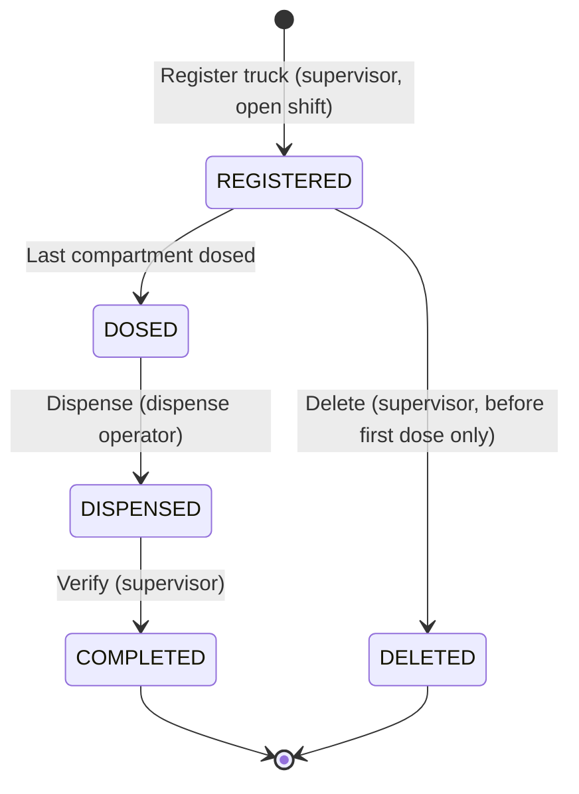
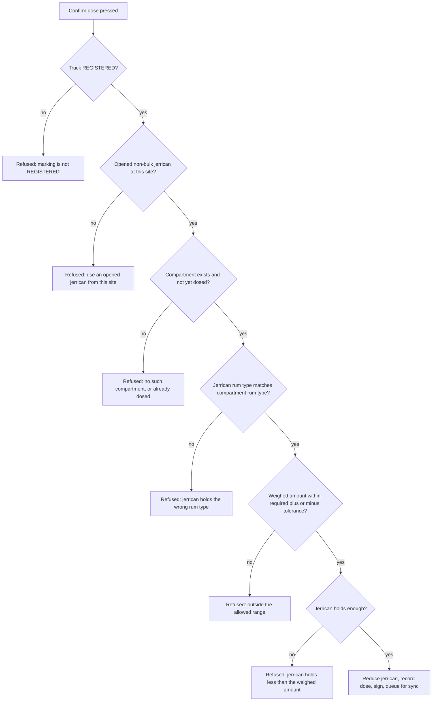

# 3. Marking

Behaviour of the truck marking workflow as it is in the current working tree of branch `fix/transfer-pull-ordering`
(uncommitted changes included). The workflow is: **register** a truck with its compartments (3.1), **dose** each
compartment from an opened jerrican on the scale (3.2), **dispense** the dosed truck (3.3), and **verify** it (3.4).
Every statement is taken from the code, the database migrations and the tests named in the code references. Where the
code does not do something, the section says so.

Scope: 3.1 Register marking (3.1.1 Compartment details), 3.2 Dosing (3.2.1 Dose cancellation), 3.3 Dispensing, 3.4 Verify.

Terms used below:

- **Desktop** is the JavaFX app at each marking site (`src/`).
- **Central** is the Spring backend that receives the site's changes (`backend/`).
- **Web** is the Angular app that head office uses to read them (`web/`).
- **Rum** amounts are grams (`g`). Fuel volumes are litres (`L`). The `*_ml` column and field names are historical.
- A **shift** must be open for the supervisor to register trucks (see [01-shift-management.md](01-shift-management.md)).

## At a glance

| Feature | Status | Where | Role |
|---|---|---|---|
| 3.1 Register marking | Implemented | Desktop, Register truck screen | Supervisor (open shift needed) |
| 3.1.1 Compartment details | Implemented | Desktop, Register truck, Load card | Supervisor |
| 3.2 Dosing | Implemented (weighed, one compartment at a time) | Desktop, Dose screen | Dosing operator |
| 3.2.1 Dose cancellation | **Not found in code.** Closest: a supervisor can delete a registered truck before its first dose | Desktop, Register truck, "Delete this truck" | Supervisor |
| 3.3 Dispensing | Implemented (a signed sign-off of the dosed truck; no quantity is entered) | Desktop, Dispense screen | Dispense operator |
| 3.4 Verify | Implemented | Desktop, Verify screen | Supervisor |

Web (all of 3.x): **read-only** listing and detail pages, "Markings" and "Marking detail".

## Marking lifecycle

A truck marking moves through the statuses below. Deletion is possible only from `REGISTERED`, and only before its first
dose. Nothing moves a marking backwards.

A truck with some compartments dosed stays `REGISTERED` until its last compartment is dosed. Its dose rows are in the
database, but the status and the dosed time change only at that point.

---

## 3.1 Register marking

**Status:** Implemented.

**Where / who:** Desktop, **Register truck** screen. Only a **Supervisor** sees it (`MainView`), and the service requires
the supervisor role. The screen is locked until a shift is open. The web app cannot register a truck.

**Preconditions**

- A shift is open at the site (the service refuses with "No open shift").
- The supervisor is signed in. A signature is required (the service refuses with "Signature is required").
- The oil marketing company (OMC) is one of the active companies in master data.
- Each fuel used on the truck is a fuel type in master data **with a rum type set** (set by head office in the web app).
  A fuel without a rum type cannot be registered.
- The declared volume (the sum of the loaded volumes, see 3.1.1) is between **100 L and 50,000 L** by default
  (`fuel-marking.validation.min-declared-volume` and `max-declared-volume`).

**Behaviour, step by step**

1. Enter the **truck number** (required). It is stored trimmed and in upper case.
2. Optionally enter the **trailer / wagon number**. Blank means none. It is stored trimmed and in upper case.
3. Choose the **oil marketing company** from the list.
4. Add the **compartments** (3.1.1). The **Total loaded (L)** field follows the compartments and cannot be edited.
5. The summary strip shows the rum to dose, in total and for each rum type. Its text reads, for example,
   "one dose per rum type, each within 2% (10 g per 1,000 L)" (the values come from configuration).
6. Press **Review & sign**. A confirmation lists the truck, trailer, company, declared volume, each compartment with its
   fuel and rum type, and the rum to dose for each rum type, then asks "Sign to register?".
7. On OK the signature pad opens with the prompt "NAME - sign the registration". Cancelling the pad ends the action
   silently; nothing is saved.
8. The service checks everything again (see the messages below), then in one transaction it:
   - saves the marking with status `REGISTERED`;
   - saves the compartments, with their fuel and rum type as they are at this moment;
   - gives the truck an order number: the site code, then the date and time to the second (for example
     `SITE-yyyyMMdd-HHmmss`). If two trucks are registered in the same second, `-2`, `-3` ... is added;
   - saves the signature for the step "Registration";
   - queues the marking and the signature for sync.
9. The form is cleared, the "Registered, waiting to be dosed" list is refreshed, and the message reads
   "Registered. Order number: ORDER".

**Validation rules and error messages**

Shown before signing (the screen):

| Condition | Message |
|---|---|
| No OMC chosen | "Select the oil marketing company" |
| No compartment | "Add at least one compartment" |
| Compartment has a fuel with no rum type | "FUEL has no rum type yet - head office sets it in the web app" |

Refused by the service, after the user has signed (the signature is not kept, because the transaction is rolled back):

| Condition | Message |
|---|---|
| No open shift | "No open shift" |
| Truck number blank | "Truck number is required" |
| No compartment | "Add at least one compartment" |
| Compartment capacity not above zero | "Compartment N needs a capacity" |
| Compartment loaded below zero | "Compartment N has a negative volume" |
| Compartment loaded above its capacity | "Compartment N exceeds its capacity" |
| Compartment without a fuel | "Select the fuel type of compartment N" |
| Declared volume outside the limits | "Declared volume must be between 100.0 and 50000.0 L" (limits from configuration) |
| Fuel not in master data | "Unknown fuel type CODE" |
| Fuel has no rum type | "Fuel type NAME has no rum type yet - head office sets it in the web app" |
| Rum type of the fuel not in master data | "Rum type CODE of fuel NAME is not available" |
| No signature | "Signature is required" |
| Caller is not a supervisor | "Action not permitted for role ROLE" |

Entry messages on the compartment row (3.1.1) are listed there.

**Data and state changes**

- `truck_markings` row: `status = REGISTERED`, `uuid` (the identity used everywhere else), `order_number`, truck and trailer
  numbers, OMC name and id, site id, shift id, `registered_by`, `declared_volume` (sum of loaded litres),
  `fuel_type` and `rum_type` (each fuel or rum code once, joined with `+` when there is more than one).
  No dose is recorded yet, so the calculated and measured dose fields are empty.
- `compartment_details`: one row per compartment with capacity, loaded volume, fuel code and rum type code.
- `signatures`: one row, step "Registration", for the supervisor.
- Outbox: `TRUCK_MARKING` (the whole marking, including compartments) and `SIGNATURE` (the PNG, base64).

**Sync and reporting impact**

- Central stores the marking as its latest version and shows it on the web as registered, with rum (g) 0.0 and
  "not yet dosed" on the detail page.
- Web, **Markings** list: a new row with its order, truck, trailer, site, location (the shift's location, if any), OMC,
  fuel, declared volume and status. The default date range is the last 30 days.
- Web, **Marking detail**: details, compartments (fuel, rum type, capacity, loaded), the signature for Registration,
  and the timeline with "Registered" filled in.

**Review notes**

1. **Signing happens before validation.** Both the confirmation and the signature come before the service refuses a
   registration. A refused registration (for example, declared volume below 100 L, or no open shift) is found only after the
   supervisor has signed. Question: should the checks run before the signature pad opens?
2. **No check for a duplicate truck.** The same truck number can be registered twice in a shift, or in a later shift, with
   no warning. Order numbers are unique, but truck numbers are not. Question: should a truck already registered and not yet
   completed be refused or flagged?
3. **Registration time comes from the desktop clock**, not from the database. Shift start and end times come from the
   database. A site whose desktop clock is wrong will show marking times that disagree with shift times. Not verified in a
   running system.
4. **The OMC is stored by name as well as by id**, so later renames do not change the name shown on past markings.
   (This is what the code does; whether it is intended was not stated.)
5. **The compartment rule and the declared volume are set by different limits.** The configuration also has minimum and
   maximum compartment capacities (50 L and 10,000 L by default). These are read by configuration code but **no
   registration check uses them**, so a compartment of any positive capacity is accepted. Question: are these limits meant
   to apply?
6. **The truck's location is not on the marking.** The place of work is on the shift (1.1). The marking carries the shift
   id, so the location is found through the shift.
7. **Legacy overloads:** `MarkingService` still has register methods that take one fuel for the whole truck. The screen does
   not use them; they are kept for older callers and tests.

**Code references**

- `ui/RegisterTab.java`: the form, `register()` (confirmation text, signature pad), `refresh()`, `refreshPending()`.
- `service/MarkingService.java`: `register(...)` (the compartment-list overload: all checks, order number, signature,
  save) and the legacy overloads.
- `dao/TruckMarkingDao.java`: `insert`, `uniqueOrderNumber`.
- `dao/SignatureDao.java`: `save` (step "Registration").
- `dao/MasterDataDao.java`: `omcs`, `fuelTypes`, `fuelType`, `rumType`.
- `model/TruckMarking.java`: constructor (registration time), `getRequiredDoses`, `calculateRequiredRum`.
- Migrations: `V1__Create_initail_tables.sql` (truck markings), `V3__Create_triggers_and_functions.sql` (status and volume
  checks), `V5__Marking_sites_shifts_inventory_sync.sql` (site, shift, OMC and signature columns),
  `V12__Fuel_rum_types_registered_jerricans.sql` (fuel rum types), `V17__Trailer_number.sql` (trailer number),
  `V21__Compartment_fuel_and_doses.sql` (compartment fuel and rum type).
- Tests: `DosingIT` (trailer number optional and upper case, order numbers unique within a second),
  `WorkflowIT` (register with two compartments), `DeleteMarkingIT` (registered trucks can be removed).
- Central: `backend/.../sync/PayloadChecks.java` (`TRUCK_MARKING` checks), `backend/.../web/ReadService.java`
  (`markings`, `marking`), `web/src/app/pages/markings.component.ts`, `web/src/app/pages/marking-detail.component.ts`.

---

### 3.1.1 Compartment details

**Status:** Implemented.

**Where / who:** Desktop, **Register truck** screen, the **Load** card. Supervisor only.

**Fields**

| Field | Rule |
|---|---|
| Compartment number | Assigned automatically: C1, C2 ... in the order added. After a removal the numbers are renumbered with no gaps. |
| Capacity (L) | Required, above zero. |
| Loaded (L) | Optional; blank means full (loaded = capacity). Not below zero, and not above capacity. |
| Fuel | Required. Chosen from master data fuel types. There is no default: the supervisor says what each compartment carries. |
| Rum type | Not chosen; derived from the fuel. A hint under the fuel box shows it: "FUEL is marked with RUM." |

**Behaviour**

1. Enter capacity and, optionally, loaded litres. Choose the fuel. Press **Add compartment** (or Enter in the loaded box).
   The compartment joins the table with its number, fuel, rum type, capacity and loaded volume.
2. **Remove selected** deletes the selected compartment and renumbers the rest.
3. The **Total loaded (L)** field and the line under the table show the number of compartments, the total loaded, and the
   number of fuels when there is more than one ("2 compartment(s), 10,000 L loaded, 2 fuels").
4. Each compartment's dose is worked out from its loaded litres, not from its capacity:
   **target (g) = loaded litres / 1,000 x 10 g** (10 g per 1,000 L by default). The total dose is the sum over compartments,
   and is shown per rum type. Compartments with the same rum type add up in that rum type's line.

**Validation rules and error messages** (the entry row)

| Condition | Message |
|---|---|
| Capacity or loaded not a number | "Compartment capacity must be a number" / "Loaded volume must be a number" |
| Capacity not above zero | "Compartment capacity must be more than zero" |
| Loaded below zero | "Loaded volume cannot be negative" |
| Loaded above capacity | "Loaded volume (X L) is more than the capacity (Y L)" |
| No fuel chosen | "Select the fuel in this compartment" |
| Fuel has no rum type | "FUEL has no rum type yet - head office sets it in the web app" |

The service repeats the checks: capacity above zero, loaded not negative, loaded not above capacity, fuel present and
known, fuel's rum type set and known.

**Data and state changes:** one `compartment_details` row per compartment, with its fuel code and the rum type code **as it
was when the truck was registered**. Later changes to a fuel's rum type in the web app do not change existing trucks.

**Sync and reporting impact:** the compartments are part of the `TRUCK_MARKING` payload. Web, **Marking detail**, shows a
compartments table (number, fuel, rum type, capacity, loaded). The web's "Rum type" line on the details card joins the
rum types of the truck with " + ".

**Review notes**

1. **A zero-litre compartment can never be dosed.** The screen accepts a loaded volume of zero, and the service only refuses
   negative volumes. The target for such a compartment is 0 g, but a dose must be above zero and within tolerance of 0 g,
   so no dose can be recorded. The truck then stays `REGISTERED` and blocks the shift from closing, and the only way out is
   deletion, which is allowed only before the first dose. Found by reading the code; no test covers it. Question: should
   a compartment need some volume?
2. **Capacity limits are not enforced** (see 3.1, review note 5).
3. **The fuel's rum type is taken at registration.** Head office can change a fuel's rum type later; the marking keeps the
   one it had. That is the intent of storing it on the compartment, but it means an old truck can carry a rum type that the
   fuel no longer has. Question: confirm this is the intent.
4. **Old jerricans can have no rum type.** A jerrican's rum type is set when it is received, but the column allows empty
   values for older rows. If a truck needs two rum types, dosing from such a jerrican is refused with a message that says
   "holds rum type null" (see 3.2). With one rum type the dose is accepted. Not verified on a real database.

**Code references**

- `ui/RegisterTab.java`: `addCompartment()`, `removeSelectedCompartment()`, `compartmentsChanged()`, `summaryChanged()`,
  `doses()`, the fuel hint (`compartmentFuel` listener).
- `service/MarkingService.java`: `register(...)` compartment checks.
- `model/CompartmentDetail.java`, `model/TruckMarking.java` (`getRequiredDoses()`, `getFuelBreakdown()`).
- `config/YamlConfigurationLoader.java`: `FuelMarking` (rum dosage, tolerance and validation limits).
- `src/main/resources/application.yml`: `fuel-marking` section (defaults above).
- Migrations: `V21__Compartment_fuel_and_doses.sql`.
- Tests: `WorkflowIT` (two compartments, 6,000 L and 4,000 L), `DosingIT` (per-compartment targets).

---

## 3.2 Dosing

**Status:** Implemented. Dosing is weighed, and done **one compartment at a time**.

**Where / who:** Desktop, **Dose** screen. Only a **Dosing operator** has this screen (`MainView`). A supervisor does not see
it, and the service refuses any other role ("Action not permitted for role ...").

**Preconditions**

- The truck is `REGISTERED` and at least one compartment is still to dose. The **Waiting for rum** list shows the trucks of
  the open shift that are `REGISTERED`, with "N of M compartments dosed".
- The compartment is not already dosed.
- The jerrican is **opened** (`OPENED`), is a jerrican (not a bulk container such as an IBC or drum), is **at the same site**
  as the truck, and holds the **rum type of that compartment's fuel**.
- The jerrican holds at least the measured amount.
- A scale is available (the scale driver is set in configuration; the default is a simulator).
- A signature is given.

**Dose rule**

- **Required dose** for a compartment = its loaded litres / 1,000 x 10 g.
- **Accepted range** = required dose +/- 2% (configuration `fuel-marking.dose-tolerance-percent`). The edges are included.
- The **weighed** amount, not the required amount, is what leaves the jerrican and what is recorded.

**Behaviour, step by step**

1. The operator sees the **Waiting for rum** list. Each truck shows its order, company, volume, the number of compartments
   dosed, and the rum still to dose.
2. The operator selects a truck. The compartment list shows each compartment with its fuel, litres, rum type, target (g),
   measured (g) once dosed, and a "To dose" or "Dosed" tag. The first compartment still to dose is selected.
3. The **dosing panel** shows the compartment's target and accepted range, a gauge, a **live scale reading** (polled about
   every 300 ms), and the boxes **Measured dose (g)** and **Jerrican**.
4. The operator puts an empty container on the scale and presses **Tare scale**.
5. The operator draws rum from an opened jerrican of the right rum type until the weight is near the target. The feedback
   line says how far short or over the target the reading is.
6. **Read scale** waits up to the configured stable wait (default 5 seconds) for a steady reading, then fills the measured
   box with grams to one decimal place. The operator can also type a figure; a typed figure is recorded as **MANUAL**,
   whereas a figure that is still the one read from the scale is recorded as **SCALE**.
7. The operator types or scans the **jerrican barcode**.
8. **Confirm dose & sign** checks that a truck, a compartment, a measured amount and a barcode are present, then shows a
   confirmation with the amounts. On OK the signature pad opens ("NAME - sign to confirm dosing"). Cancelling the pad ends
   the action silently.
9. The service checks the dose again (messages below). If it passes, in one transaction it:
   - reduces the jerrican's rum by the **weighed** amount (and queues the jerrican for sync);
   - records a dose row for the compartment: required grams, measured grams, source, jerrican, operator, time;
   - updates the truck totals;
   - marks the truck `DOSED` only when every compartment has a dose;
   - saves a signature for the step "Dosing";
   - queues the marking and the signature for sync.
10. If compartments are still to dose, the next one is selected and the message reads "Dosed X g for compartment C. Still to
    dose: C2." If none is left in the list, the message reads "Dosed X g. Hand the container to the dispense operator."

**Validation rules and error messages**

Shown by the screen before signing:

| Condition | Message |
|---|---|
| No truck or no compartment selected | "Choose a truck and a compartment first." |
| Nothing read or typed | "Read the dose from the scale first" |
| Measured box not a number | "The measured dose must be a number of grams" |
| No jerrican barcode | "Scan the jerrican barcode" |

Shown by the confirmation text: "Record a dose of X g (target Y g) for compartment C of truck T (FUEL, L L) from jerrican J?"
and, for typed figures, "This number was typed in, not read from the scale, and will be marked as manual."

Refused by the service, after the user has signed (nothing is changed):

| Condition | Message |
|---|---|
| Marking not found | "Unknown marking" |
| Marking not `REGISTERED` | "Marking ORDER is STATUS, expected REGISTERED" |
| Jerrican not found | "Unknown jerrican" |
| Jerrican not opened, is bulk, or at another site | "Use an opened jerrican from this site" |
| No compartment given and none left for this rum type | "Every compartment that takes RUM is already dosed - still to dose: C2 (RUM), ..." |
| Jerrican's rum type not used by this truck | "This jerrican holds rum type CODE but this truck is to be marked with RUM1 and RUM2" |
| Named compartment not on this truck | "This truck has no compartment C" |
| Compartment already dosed | "Compartment C is already dosed" |
| Jerrican's rum type differs from the compartment's | "This jerrican holds rum type CODE but compartment C (FUEL) is to be marked with RUM" |
| Weighed amount outside tolerance | "The dose of X g is outside the allowed range: compartment C needs Y g of RUM (+/- Z g). Add more rum, then read the scale again." (too little) or "... Too much rum was drawn - start again with a fresh container." (too much) |
| Jerrican holds less than the weighed amount | "Jerrican holds X g, need Y g" |
| Measured amount not above zero | "The measured dose must be more than zero" |
| Source not SCALE or MANUAL | "Dose source must be SCALE or MANUAL" |
| No signature | "Signature is required" |
| Role is not dosing operator | "Action not permitted for role ROLE" |

On screen, after a refused dose, nothing changes and the dialog shows the message.

The gauge text on screen (before any confirmation): "X g short of the target - add about Y g more.",
"X g over the target - too much; start again with a fresh container.", or "Within range (+X g from the target)."

**Data and state changes**

- `containers`: the jerrican's volume is reduced by the weighed amount. If it reaches zero the jerrican becomes `EMPTY`
  and its seals are discarded.
- `marking_doses`: one row per compartment: compartment, rum type, required grams, measured grams, source (`SCALE` or
  `MANUAL`), jerrican, operator, time. One dose per compartment per marking.
- `truck_markings`: `dose_calculated_ml` = the required rum for the **whole truck** (all compartments, set at each dose);
  `dose_measured_g` = sum of weighed doses so far; `dose_source` = `MANUAL` if any dose was typed, otherwise `SCALE`;
  `dose_container_id` = the last jerrican; `dosed_by` = the last operator; `dosed_time` and `status = DOSED` only when all
  compartments are dosed.
- `signatures`: one row per dose, step "Dosing".

**Sync and reporting impact**

- Each dose queues the marking, the jerrican's new volume and the dose signature. A truck part-dosed on the desktop is
  visible to head office in its current state.
- Web, **Markings** list: "Rum (g)" shows the weighed total dosed so far (or the calculated figure before any dose).
- Web, **Marking detail**: "Rum required" is the whole truck's requirement. "Rum dosed" is the weighed total, with a badge
  "weighed on scale" (SCALE) or "entered manually" (MANUAL). The **Doses** table shows each compartment's target, weighed
  amount, source and time. The timeline's "Dosed" entry stays "pending" until the last compartment is dosed.

**Review notes**

1. **The signature comes before the tolerance check.** The confirmation and signature pad appear first; a dose outside the
   tolerance is refused only after signing. The gauge on screen warns earlier, but nothing stops the signature. Question:
   should the range be checked before the signature pad opens?
2. **Typed doses are accepted without a second person.** A dose typed in (MANUAL) within tolerance is recorded and flagged on
   the web with "entered manually". There is no supervisor approval. Question: is a manual dose acceptable without review?
3. **Supervisors cannot dose.** Only the dosing operator has the Dose screen. Supervisors can delete an undosed truck and
   verify a dispensed one, but neither role can change a recorded dose (see 3.2.1).
4. **The shift is not checked by the dosing service.** The screen only lists trucks of the open shift, so in normal use
   doses happen during the shift. The service itself does not check that a shift is open for dosing (register and delete do).
   Not verified whether this matters in practice, since a shift cannot be closed while a truck is not verified.
5. **The operator's site is not checked, only the jerrican's.** A dosing operator at one site could be given another site's
   marking through the service; the jerrican must be at the marking's site. The screen only shows the site's own trucks.
6. **The dosing operator of each dose is not in the synced dose data.** The desktop keeps the operator for each dose row, but the
   dose list that goes to central has no operator field. The web shows who signed each dose only through the Signatures
   section of the marking detail page.
7. **`dose_calculated_ml` holds the whole truck's requirement**, not the requirement of the compartment dosed. It is set to
   the full total at each dose, so it is the same from the first dose onwards. The name is historical.
8. **A jerrican without a rum type** is refused with "holds rum type null" only when the truck needs two rum types
   (see 3.1.1 review note 4).
9. **A zero-litre compartment cannot be dosed** (see 3.1.1 review note 1).
10. **The weighed value depends on the scale.** The scale driver is configurable, and the default is a simulator. A real scale
    has to be set up in configuration; the docs for that are outside this page.

### 3.2.1 Dose cancellation

**Status:** **Not found in code.**

**What was searched:** the service, the DAO, the screens and the schema were checked for any operation that reverses a dose,
puts rum back into a jerrican, or moves a marking back to an earlier status. Nothing exists. The database has no column for
voided doses, and the `marking_doses` table has no status.

**Closest behaviour that exists**

1. **Delete a registered truck before its first dose** (a supervisor action on the Register truck screen).
   - Select the truck in **Registered, waiting to be dosed** and press **Delete this truck**. The button is enabled only for a
     truck that has no dose yet.
   - Confirmation: "Delete the registration of truck T (ORDER)? It will no longer appear anywhere and cannot be dosed. It stays on
     record as deleted."
   - The marking becomes `DELETED` with the time and the deleting supervisor kept. It is hidden from listings and counts
     nowhere; the shift does not wait for it. The status is queued for sync. Web, **Markings**: hidden unless the status
     filter is set to DELETED.
   - Who: supervisor only. Requires an open shift.
   - Messages: "Start a shift first", "This marking belongs to another site", "Marking ORDER is already deleted",
     "Truck T has already been dosed (N of M compartments) - a marking cannot be deleted once dosing has started",
     "Marking ORDER is STATUS - it can no longer be deleted".
   - A truck with a dose cannot be deleted, not even if only one of several compartments is dosed.
2. **Refused doses change nothing.** A dose outside tolerance, or from the wrong jerrican, is refused before anything is
   written (3.2). This is the only "cancel" the operator has before a dose is recorded. The **Confirm dose & sign** press is
   the commit point.
3. **Incidents** can record rum lost from a named jerrican, which reduces that jerrican's volume and shows up as a loss in the
   shift reconciliation (1.3). This records a loss; it does not undo or correct a dose.

**Review notes**

- **A wrong dose cannot be corrected.** Once a compartment is dosed, the rum has left the jerrican and the dose row stays.
  The only ways to correct the picture are: an incident, which changes the reconciliation, or deleting the truck, which is
  refused after the first dose. Question: is a supervisor-approved reversal wanted? If so it has to put rum back in the
  jerrican, correct the truck's totals, keep an audit record, and queue the changes for sync.
- **A partly dosed truck cannot be deleted**, so a truck with a wrong first compartment has to go on to be dosed, verified and
  dispensed as it is.
- **Deleted markings are kept** with the deleting supervisor and time. The web hides them from listings by default, and they
  cannot be recovered in the app.

**Code references**

- `service/MarkingService.java`: `delete(AppUser, Site, Shift, UUID)`; the refusal messages.
- `dao/TruckMarkingDao.java`: `recordDeletion`, `listByShift` (deleted markings excluded unless asked for).
- `ui/RegisterTab.java`: `deleteSelected()`, `pendingChosen(...)`, the "Delete this truck" button and hint texts.
- `service/IncidentService.java`: incidents that reduce jerrican volume.
- Migrations: `V23__Delete_marking.sql` (status `DELETED`, `deleted_time`, `deleted_by`).
- Tests: `DeleteMarkingIT` (deletion before the first dose; refused once dosing has started; refused for other sites and roles).
- Web: `backend/.../web/ReadService.java` (`markings`, default exclusion of `DELETED`).

---

## 3.3 Dispensing

**Status:** Implemented. Dispensing is a **signed sign-off** that the rum has been put into the truck. The system does not
measure anything at this step: the amount recorded as dispensed is the weighed dose from 3.2.

**Where / who:** Desktop, **Dispense** screen. Only a **Dispense operator** has this screen. The service requires the
dispense operator role.

**Preconditions**

- The truck is `DOSED` (every compartment dosed). A truck with some compartments still to dose does not appear.
- A signature is given.
- The **Dispense** list shows the trucks of the open shift that are `DOSED`, with the columns order, truck, trailer, company,
  fuel, volume, and "Rum to dose (g)".

**Behaviour, step by step**

1. The dispense operator selects the truck in the list.
2. Presses **Rum dispensed - sign**. The signature pad opens with "NAME - sign to confirm rum dispensed into truck T".
   Cancelling ends the action silently.
3. The service checks the status and role, then in one transaction records the dispense, saves the signature (step
   "Dispensing") and queues the marking and signature for sync.
4. The list is refreshed and the message "Dispensing recorded." is shown.

**Validation rules and error messages**

| Condition | Message |
|---|---|
| No truck selected | "Select a truck first." |
| Marking not found | "Unknown marking" |
| Marking not `DOSED` | "Marking ORDER is STATUS, expected DOSED" |
| No signature | "Signature is required" |
| Role is not dispense operator | "Action not permitted for role ROLE" |

**Data and state changes**

- `truck_markings`: `status = DISPENSED`; `dispensed_time` = database time; `dispensed_by`;
  `rum_used` = the weighed total (or the calculated total if no weighed figure exists).
- `signatures`: one row, step "Dispensing".
- Outbox: `TRUCK_MARKING` and `SIGNATURE`.

**Sync and reporting impact**

- Web, **Marking detail**: "Dispensed" in the timeline gets its time. The status badge shows DISPENSED.
- Web, **Markings** list: status DISPENSED. The rum column shows the weighed total.

**Review notes**

1. **No check that the truck was really filled.** The sign-off is the only record. Nothing ties the dispense to a quantity
   entered at this step.
2. **The Dispense queue shows "Rum to dose (g)", the required figure, not the weighed figure.** Operators may read it as the
   amount to be dispensed. The weighed amount is only on the Dose screen and the web detail page.
3. **No shift or site checks in the service.** The screen lists only the open shift's trucks, but the service accepts any
   `DOSED` marking. Question: is a site or shift check wanted here, as for register and delete?
4. **Dispense happens for the whole truck at once**, because the status requires every compartment to be dosed. There is no
   per-compartment dispense.

**Code references**

- `ui/DispenseTab.java` (the screen: one action, the sign-off message).
- `ui/MarkingStepTab.java` (the shared queue layout, the waiting list by status and shift, the column "Rum to dose (g)").
- `service/MarkingService.java`: `dispense(AppUser, UUID, byte[])`.
- `dao/TruckMarkingDao.java`: `recordDispense` (`rum_used` rule).
- `dao/SignatureDao.java`: `save` (step "Dispensing").
- Tests: `WorkflowIT` (dispensing refused before the truck is dosed), `DosingIT` (dispensed amount is the weighed one).

---

## 3.4 Verify

**Status:** Implemented.

**Where / who:** Desktop, **Verify** screen. Only a **Supervisor** sees it, and the service requires the supervisor role.

**Preconditions**

- The truck is `DISPENSED`.
- A signature is given.
- The **Verify** list shows the trucks of the open shift that are `DISPENSED`.

**Behaviour, step by step**

1. The supervisor selects the truck.
2. Presses **Verified - sign**. The signature pad opens with "NAME - sign to verify marking ORDER". Cancelling ends the action silently.
3. The service checks the status and role, then in one transaction marks the truck `COMPLETED`, records the verifier and the
   time, saves the signature (step "Verification") and queues the marking and signature for sync.
4. The list is refreshed and "Marking completed." is shown.

**Validation rules and error messages**

| Condition | Message |
|---|---|
| No truck selected | "Select a truck first." |
| Marking not found | "Unknown marking" |
| Marking not `DISPENSED` | "Marking ORDER is STATUS, expected DISPENSED" |
| No signature | "Signature is required" |
| Role is not supervisor | "Action not permitted for role ROLE" |

**Data and state changes**

- `truck_markings`: `status = COMPLETED`; `completed_time` and `verified_time` = database time; `verified_by`.
- `signatures`: one row, step "Verification".
- Outbox: `TRUCK_MARKING` and `SIGNATURE`.

**Sync and reporting impact**

- Verification is the last workflow step. A shift cannot close while any of its markings is not `COMPLETED` (or `DELETED`)
  (see 1.3).
- Web, **Marking detail**: the timeline's "Verified" time is filled in, and the status badge shows COMPLETED.
- Web, **Markings** list: status COMPLETED.

**Review notes**

1. **No separation of duties.** The supervisor who registered a truck can verify it. The service does not compare the two.
   Question: should the verifier be a different person from the one who registered it?
2. **Verification records no quantity or check.** It is a signed attestation. It does not compare the weighed amount with the
   requirement or with the dispensed amount again.
3. **No shift or site check in the service.** As for 3.3.
4. **Two identical timestamps.** `completed_time` and `verified_time` are both set to the same database time. This is harmless
   but worth knowing when reading the data.

**Code references**

- `ui/VerifyTab.java` (the screen).
- `ui/MarkingStepTab.java` (the shared queue layout, waiting list by status and shift).
- `service/MarkingService.java`: `verify(AppUser, UUID, byte[])`.
- `dao/TruckMarkingDao.java`: `recordVerification`.
- `service/ShiftService.java`: `countUnverified` (what blocks shift close).
- Tests: `WorkflowIT` (verification completes the marking; shift cannot close before it), `CloseBackIT` (verified markings no
  longer block the close).

---

## Cross-cutting notes for reviewers

- **Single terminal assumption.** The screens hold the open shift and the current truck in memory. Two terminals at one site
  working on the same truck could see stale queues; the service then refuses by status (for example, "expected DOSED").
  No test with two terminals was found.
- **Signatures are stored as PNG and synced in base64.** Central keeps each signature unchanged once stored (`SIGNATURE` rows
  cannot be changed), and shows them on the marking detail page with the signer's name and the time recorded on the site.
- **Idle lock.** After a period with no input the desktop signs out (configuration `fuel-marking.ui.idle-lock-seconds`,
  default 600 seconds, 0 disables). Open dialogs are closed too. A signature pad closed this way returns nothing, so the
  action ends without saving and must be started again.
- **Web read access.** Viewer or Admin roles on the central system (`/api/web/**`). No marking can be changed on the web.
